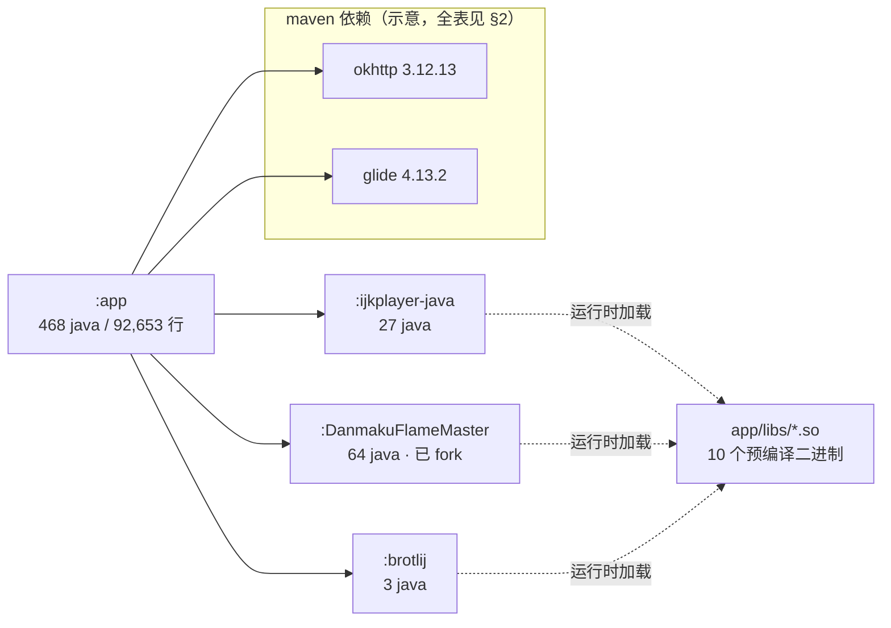

# 依赖地图（dependency-map）

> 定位：**回答"这个问题能不能靠换/升依赖解决"**。多数时候答案是"不能"——播放内核、TLS、仓库镜像都是锁死的。改 `build.gradle`/`settings.gradle` 前必读；只看模块归属读 [module-map](./module-map.md)。

## 1 模块依赖图



- 依赖声明：`app/build.gradle:163-165` 三行 `implementation project(...)`；三个 library 互不依赖，且都没有外部 maven 依赖（叶子模块）。
- 仓库统一在 `settings.gradle` 声明，模块内禁止自带 `repositories {}`：`dependencyResolutionManagement` + `RepositoriesMode.FAIL_ON_PROJECT_REPOS`（`settings.gradle:18-19`）。

## 2 app 关键第三方依赖（逐行核对 `app/build.gradle:133-179`）

| 依赖 | 版本 | 声明行 | 用途（代码/注释可证） | 可升级？ |
|---|---|---|---|---|
| `com.google.zxing:core` | 3.3.0 | `:135` | 登录扫码二维码 | **否**，注释 `//noinspection GradleDependency` 刻意锁旧 |
| `androidx.appcompat:appcompat` | 1.5.1 | `:137` | 兼容层基类（`BaseActivity` 继承 `AppCompatActivity`） | **否**，刻意锁旧 |
| `com.google.android.material:material` | 1.9.0 | `:139` | MDC 组件（卡片/按钮/对话框） | 慎，与旧系统主题覆盖层耦合 |
| `com.squareup.okhttp3:okhttp` | **3.12.13** | `:141` | 全部网络（`NetWorkUtil` 单例） | **否**，见 §5 |
| `org.conscrypt:conscrypt-android` | **2.5.2（锁死）** | `:146` | 仅崩溃上报通道的老设备 TLS 回移 | **否**，见 §5 |
| `androidx.swiperefreshlayout` | 1.1.0 | `:147` | 列表下拉刷新（`RefreshListActivity` 基座） | 可 |
| `com.github.bumptech.glide:glide` | 4.13.2 | `:148` | 图片加载（`helper/CustomGlideModule` 接 OkHttp） | 可，需同步 okhttp 集成版本 |
| `glide:okhttp3-integration` | 4.13.2 | `:149` | Glide 走全局 OkHttp（Cookie/头一致） | 必须与 glide 同版本 |
| `glide:compiler` | 4.13.2 | `:150` | annotationProcessor | 必须与 glide 同版本 |
| `org.jsoup:jsoup` | 1.15.3 | `:152` | HTML 解析（专栏/网页抓取/第三方源） | 可，proguard 有 `-keeppackagenames org.jsoup.nodes`（`proguard-rules.pro:23`） |
| `com.github.chrisbanes:PhotoView` | 2.3.0 | `:154` | 看图页手势缩放 | 可，来自 jitpack |
| `org.greenrobot:eventbus` | 3.2.0 | `:155` | 全局事件总线（`BaseActivity:584`） | 慎，反射语义与 API19 相关 |
| `androidx.asynclayoutinflater` | 1.0.0 | `:166` | 后台 inflate（另有自研 `AsyncLayoutInflaterX`） | 可 |
| `androidx.constraintlayout` | 2.1.4 | `:167` | 布局 | 可 |
| `androidx.multidex` | 2.0.1 | `:168-169` | `MultiDex.install`（`BiliTerminal.java:84`） | 可 |
| `com.google.protobuf:protobuf-javalite` | 3.21.12 | `:172` | 私信 gRPC 响应、弹幕分段 protobuf | 慎，与 `util/ProtobufParser` 解析假设绑定 |
| `com.google.code.gson:gson` | 2.8.9 | `:173` | JSON 模型（`model/*`） | 可，proguard 有多条 Gson 规则 |
| `junit` / `androidx.test:runner` / `core` | 4.13.2 / 1.5.2 / 1.5.0 | `:175-177` | 仅 `androidTestImplementation`（全仓唯一仪器化测试） | — |

已移除但注释仍留在文件里的历史依赖（**不是现状**，别去"修"）：Geetest SDK、DFM 的 maven 坐标、ndkbitmap aar、`org.brotli:dec`（`app/build.gradle:156-161,170-171`）。

## 3 `app/libs` 二进制与 ABI 策略

`app/build.gradle:19` `jniLibs.srcDirs = ['libs']`；仓库内共 **10 个 .so**（5 个库 × 2 个 ABI），约 13MB。**没有 NDK 源码，也没有任何 so 构建脚本**（`/opt/android-sdk` 无 NDK）。

| 文件 | armeabi-v7a | x86 | 被谁加载 |
|---|---|---|---|
| `libijkffmpeg.so` | 4,403,976 B | 6,218,076 B | ijkplayer 内核（ffmpeg） |
| `libijkplayer.so` | 260,968 B | 396,432 B | `IjkMediaPlayer` 内部 `loadLibrary` |
| `libijksdl.so` | 218,836 B | 625,480 B | ijk SDL 层（渲染/音频输出） |
| `libndkbitmap.so` | 13,452 B | 9,260 B | `DanmakuFlameMaster` 的 `tv.cjump.jni.NativeBitmapFactory` |
| `libbrotli.so` | 609,960 B | 777,504 B | `brotlij` 的 `Brotli`（`System.loadLibrary("brotli")`） |

ABI 策略（`app/build.gradle:42-47,104-116`）：

- **release 只打 `armeabi-v7a`**（`:46`）。真机 64 位设备通过 32 位兼容层运行，实际 native 崩溃率【未核实】。
- **debug 打 `armeabi-v7a` + `x86`**（模拟器用）；`-PemuArm64` 时追加 `arm64-v8a`（`:113-116`）。
- `-PemuArm64` 是**隐式开关**：该模式没有 ijk/弹幕的 arm64 so，**播放相关功能会崩**，只用于 TLS 仪器化测试（注释 `:111-115`）。
- 三个 library 模块自身都**没有** `libs/` 或 `jniLibs/` 目录（`brotlij/build.gradle` 里的 `api fileTree(libs)` 指向不存在的目录，空集无副作用）。

## 4 构建仓库与镜像分支（`settings.gradle`）

```text
if (!GITHUB_ACTIONS) { 阿里云 public / google / gradle-plugin 镜像 }   ← 仅本地开发生效
gradlePluginPortal() / google() / mavenCentral() / jitpack.io          ← 两种环境都生效
```

| 事实 | 证据 |
|---|---|
| 镜像分支由环境变量控制，**不是可选项**：`if (!System.getenv("GITHUB_ACTIONS"))` | `settings.gradle:6`（pluginManagement）、`:21`（dependencyResolutionManagement） |
| 理由写在注释里：镜像在国内网络有优势，但 **Actions 美区 runner 上阿里云经常 502**，Gradle 对 5xx 不做仓库间兜底，v1.3.3 的 tag CI 实测翻车 | `settings.gradle:3-5` |
| 已移除 jcenter 镜像（上游仓库冻结只读）与 `http://` 明文仓库、`mavenLocal` | `settings.gradle:7`、`build.gradle:1-4` |
| Gradle 分发件走腾讯镜像，wrapper 已带 `distributionSha256Sum` | `gradle/wrapper/gradle-wrapper.properties:3,4-5` |
| jitpack 仅供 PhotoView 等 GitHub 坐标 | `settings.gradle:15,27` |

**改动规则**：不要"统一仓库配置"或把镜像删掉；本地与 CI 的分叉是既成事实，删除任一侧都可能让另一侧构建失败。

## 5 不能升级 / 替换的依赖（附理由，均为代码或注释可证）

| 项 | 为什么不能动 | 证据 |
|---|---|---|
| `conscrypt-android` 2.5.2 | 2.6.x 起改用 NDK 27 构建并放弃 Android 4.x（API 19/20）；本项目 minSdk 19 | `app/build.gradle:142-145`、[decisions-tls-backport](../decisions-tls-backport.md) |
| `okhttp` 3.12.13 | 4.x 需 API 21+ 与 Kotlin 运行时；全局请求头/拦截器/`followRedirects(false)` 语义都建立在 3.x | `app/build.gradle:141`、`util/NetWorkUtil.java:80-137` |
| `ijkplayer-java` + `libijk*.so` | Java 封装与预编译 so 是**成对**的，仓库内无上游版本标记，无法判断是否同版本；换 so 无兼容保证 | `app/build.gradle:163`、【未核实】版本匹配 |
| `DanmakuFlameMaster` | 已 fork（6 个提交 / 7 个文件），不能用上游 maven 坐标替换 | [module-map](./module-map.md) §6 |
| `brotlij` + `libbrotli.so` | 原样第三方 JNI；**许可证来源未核实**（无 license 头、无 LICENSE 文件），不能随意替换/清理 | `brotlij/build.gradle:7`【未核实】 |
| `libndkbitmap.so` | 弹幕缓存绘制依赖；DFM 模块内的 `src/main/libs` 与 `app/libs` 两份同名库不可混用 | `app/libs/*/libndkbitmap.so` |
| AGP / Gradle / JDK / compileSdk | 属于基线，Phase 内不升级（AGENTS.md 硬规则）；升 compileSdk 需同步 4 个模块 | `build.gradle:6-8`、各模块 `build.gradle` |

## 6 新增依赖的硬规则

1. 只加到 `app`，版本写在 `app/build.gradle:133-179` 的依赖块，不要新建 version catalog（当前没有）。
2. 坐标必须在 `settings.gradle` 已声明的仓库范围内（google/mavenCentral/jitpack/阿里云镜像）；模块内不要加 `repositories`。
3. 需要反射/序列化的类（Gson、EventBus 订阅者、JNI 回调）要同步补 `app/proguard-rules.pro`（现有整包 keep 见 `:24-27`，Conscrypt 见 `:29-32`）。
4. 若替换任何 native 库（so），必须评估 32 位兼容层与 debug x86 两条路径，并说明无法本地验证的部分（本机不能跑 Release/仪器化）。