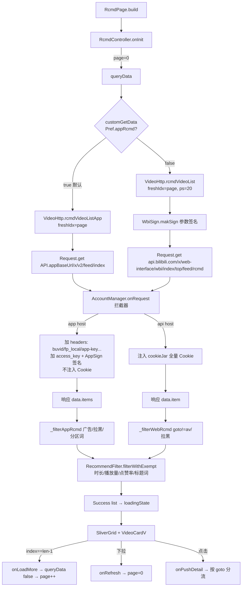

# PiliPlus 首页推荐流深度审计与移植可行性报告

> 审计对象：PiliPlus（Flutter）首页推荐流 vs Re-BiliTerminal（Java/XML）现有推荐实现
> 报告日期：2026-10-31
> 审计性质：**只读审计**。本次未修改任何 Java / XML / Gradle 业务代码，未提交 Git，未使用任何真实账号凭证。

---

## 0. 证据标记约定（全文通用）

| 标记 | 含义 |
|---|---|
| 【源码】 | PiliPlus / Re-BiliTerminal 源码可直接读到，附 `文件:行号` |
| 【实测】 | 本次用 curl 匿名真实请求验证，附实测输出 |
| 【推测】 | 基于源码或协议惯例的推断，**未经证实**，不能当作事实使用 |
| 【未验证】 | 本次没有条件验证（缺凭证、怕触发风控、无法对照官方客户端等），并写明复测方法 |

**关于"凭证"的边界说明**：本次所有实测请求均为**匿名**（无 SESSDATA、无 access_key、无任何用户 Cookie）。凡是"登录后是否个性化"这类问题，一律标为【未验证】，没有拿你的账号去试。

---

## 1. 调查范围与源码版本

### 1.1 PiliPlus 版本锚点

| 项目 | 值 |
|---|---|
| 仓库 | `https://github.com/bggRGjQaUbCoE/PiliPlus` |
| 分支 | `main` |
| **Commit SHA** | `c741279080fa90571d59ff9558640beb88861492` |
| 获取方式 | `curl https://codeload.github.com/bggRGjQaUbCoE/PiliPlus/tar.gz/refs/heads/main`（tar 包不带 `.git`，无法自证 SHA） |
| **SHA 校验方式** | 用 `raw.githubusercontent.com/.../c7412790.../lib/http/video.dart` 与本地快照 `diff`，结果 `SAME`；`lib/pages/rcmd/controller.dart` 同样 `SAME` 【实测】 |
| 依赖佐证 | `pubspec.lock` → `dio 5.11.1` |

> 说明：`api.github.com` 本次被 IP 级限流（403 rate limit），因此 commit 列表改用 `github.com/.../commits/main.atom` 读取，再用 raw 文件逐字节比对锁定 SHA。这一步是为了满足"不能只说个版本号就算数"。

### 1.2 Re-BiliTerminal 版本锚点

| 项目 | 值 |
|---|---|
| 分支 | `main` |
| HEAD | `81a1efddb27c6ccadfcd54129fe96b6dbc603cca`（`chore(site): 同步 1.2.5 release 兜底信息`，2026-10-24） |
| 工作区状态 | **有未提交改动**（38 个文件 `M`，另有新增未跟踪文件如 `ThemeColorActivity.java`、`ui/theme/`）。本次审计未触碰这些文件【实测：`git status --short`】 |
| 技术栈确认 | `app/build.gradle:29` `minSdk 19`；okhttp `3.12.13`；gson `2.8.9`；targetSdk 26 |

### 1.3 已阅读的关键源码清单

**PiliPlus**

- `lib/pages/rcmd/view.dart`、`lib/pages/rcmd/controller.dart`
- `lib/pages/common/common_list_controller.dart`、`lib/pages/common/common_controller.dart`
- `lib/http/video.dart`、`lib/http/api.dart`、`lib/http/init.dart`、`lib/http/validate.dart`、`lib/http/search.dart`、`lib/http/error_msg.dart`、`lib/http/black.dart`
- `lib/utils/accounts.dart`、`lib/utils/accounts/account.dart`、`lib/utils/accounts/account_manager/account_mgr.dart`、`lib/utils/accounts/api_type.dart`
- `lib/utils/wbi_sign.dart`、`lib/utils/app_sign.dart`、`lib/utils/id_utils.dart`、`lib/utils/login_utils.dart`、`lib/utils/recommend_filter.dart`、`lib/utils/storage_pref.dart`、`lib/utils/extension/dimension_ext.dart`
- `lib/common/constants.dart`、`lib/common/widgets/video_card/video_card_v.dart`
- `lib/models/home/rcmd/result.dart`、`lib/models/model_rec_video_item.dart`、`lib/models/model_video.dart`、`lib/models/common/account_type.dart`
- `lib/pages/setting/models/recommend_settings.dart`、`lib/pages/setting/models/privacy_settings.dart`
- Issue #3253（CLOSED / COMPLETED，正文含对照实验，评论区 2 条均指向第三方项目 BiliPai）

**Re-BiliTerminal**

- `api/RecommendApi.java`、`api/ConfInfoApi.java`、`api/LoginApi.java`
- `util/NetWorkUtil.java`、`util/CookieGenerator.java`、`util/DeviceIdentity.java`、`util/AccountManager.java`、`util/AppAuthStore.java`
- `activity/video/RecommendActivity.java`、`activity/base/RefreshMainActivity.java`、`activity/settings/SettingPrefActivity.java`、`activity/MenuActivity.java`、`activity/SplashActivity.java`
- `model/VideoCard.java`、`adapter/video/VideoCardAdapter.java`

---

## 2. PiliPlus 首页推荐流完整架构

### 2.1 组件清单

| 角色 | 实现 | 位置 |
|---|---|---|
| 页面 Widget | `RcmdPage`（`StatefulWidget` + `AutomaticKeepAliveClientMixin`） | `lib/pages/rcmd/view.dart:14` |
| 控制器 | `RcmdController extends CommonListController`（GetX `Get.put`） | `lib/pages/rcmd/controller.dart:6` |
| 分页/刷新基类 | `CommonListController` → `CommonController` | `lib/pages/common/common_list_controller.dart:5`、`lib/pages/common/common_controller.dart:36` |
| 接口层 | `VideoHttp.rcmdVideoList` / `VideoHttp.rcmdVideoListApp` | `lib/http/video.dart:52`、`lib/http/video.dart:113` |
| 网络底座 | `Request()`（dio 单例）+ `AccountManager` 拦截器 + `RetryInterceptor` | `lib/http/init.dart:24`、`lib/utils/accounts/account_manager/account_mgr.dart:22` |
| 签名 | `WbiSign.makSign`（web）/ `AppSign.appSign`（app，在拦截器内统一执行） | `lib/utils/wbi_sign.dart:111`、`lib/utils/app_sign.dart:7` |
| 数据模型 | `RcmdVideoItemModel`（web）/ `RcmdVideoItemAppModel`（app），共同基类 `BaseRcmdVideoItemModel` | `lib/models/model_rec_video_item.dart:4`、`lib/models/home/rcmd/result.dart:7` |
| 过滤 | `_filterWebRcmd` / `_filterAppRcmd` / `RecommendFilter` | `lib/http/video.dart:84`、`:93`、`lib/utils/recommend_filter.dart:17` |
| 渲染 | `VideoCardV`（垂直卡片）+ `SliverGrid.builder` | `lib/common/widgets/video_card/video_card_v.dart:23` |
| 设置 | `recommendSettings`（推荐/过滤）+ `privacySettings`（buvid/黑名单） | `lib/pages/setting/models/recommend_settings.dart:10`、`lib/pages/setting/models/privacy_settings.dart:13` |

### 2.2 完整调用链（Mermaid）



### 2.3 逐条回答"阶段一"的问题

| 问题 | 结论 | 证据 |
|---|---|---|
| 1. 由哪些组件组成 | `RcmdPage` + `RcmdController` + `VideoCardV`；无独立 Repository 层 | 见 2.1 |
| 2. 初始化做什么 | `onInit()` 里 `page = 0` 后**立即** `queryData()`；`isEnd` 被覆写为恒 `false`（无限流，永不到底） | `controller.dart:14-21` |
| 3. 谁负责调接口 | `VideoHttp`（两个静态方法），没有 DI/Retrofit | `video.dart:52/113` |
| 4. 经过哪些模型 | web→`RcmdVideoItemModel`；app→`RcmdVideoItemAppModel`，两者继承 `BaseRcmdVideoItemModel`→`BaseVideoItemModel` | `model_rec_video_item.dart:4-36`、`result.dart:7-53`、`model_video.dart:1-16` |
| 5. 谁渲染 | `VideoCardV`（竖版卡片：封面+时长角标+标题+UP+播放量+推荐理由） | `video_card_v.dart:82-263` |
| 6. 刷新/分页 | 刷新：`onRefresh()` → `page=0`；分页：`SliverGrid.builder` 在 `index == response.length - 1` 时触发 `onLoadMore()` → `queryData(false)` → `page++`（**提前一条预取**） | `controller.dart:53-58`、`view.dart:73-75`、`common_list_controller.dart:23-57` |
| 7. 点击进播放 | `onPushDetail()` 按 `goto` 分流：`bangumi`→`PageUtils.viewPgc(epId: param)`；`av`→ 缺 `cid` 时 `SearchHttp.ab2cWithDimension` 反查，再 `PageUtils.toVideoPage`；`picture`/其他→`PiliScheme.routePushFromUrl(uri)` | `video_card_v.dart:33-80` |
| 8. 缓存 | **只存内存**。`enableSaveLastData`（默认 true）在刷新时把旧列表追加到新列表之后，并插入"上次看到这里"分隔卡；`wantKeepAlive=true` 使切 Tab 不重建页面也不重拉 | `controller.dart:35-51`、`view.dart:25-27`、`view.dart:76-124` |
| 9. 广告/特殊卡 | 有：`ad_av`/`ad_web_s`/`ad_info!=null`/`can_play!=1`（app）、`goto != av`（web）、`goto == bangumi`（PGC，走 `param` 当 epId）、`goto == picture`（动态图文）、`three_point_v2`（不感兴趣原因） | `video.dart:84-110`、`result.dart:44-51`、`view.dart:33-79` |

> 注意：`RcmdController` 覆写了 `isEnd => false`，所以"到底"这个状态**不存在**，只有"这一页空了"才会停止（`common_list_controller.dart:29-39` 会置 `isEnd=true`，但对 rcmd 来说下一次 `onRefresh` 又会复位）。

---

## 3. App / Web 推荐 API 对比

### 3.1 App 端：`/x/v2/feed/index`

**请求**【源码 `lib/http/video.dart:113-163`、`lib/http/api.dart:6-7`】

```
GET https://app.bilibili.com/x/v2/feed/index
```

Query 参数（PiliPlus 全量，共 25 个）：

| 参数 | 值 | 性质 |
|---|---|---|
| `build` | `8430300` | 客户端版本号（固定配置） |
| `c_locale` / `s_locale` | `zh_CN` | 固定配置 |
| `channel` | `master` | 渠道（固定） |
| `column` | `2` | 双列瀑布流 |
| `device` / `device_name` | `phone` / `android` | 环境标识 |
| `device_type` | `0` | 环境标识 |
| `disable_rcmd` | `0` | 不关推荐 |
| `flush` | `8` | 客户端行为位 |
| `fnval` / `fnver` | `976` / `0` | 取流能力位（与推荐无关，官方客户端同款） |
| `force_host` | `2` | 强制 https |
| `fourk` | `1` | 4K 能力位 |
| `guidance` | `1` | 引导位 |
| `https_url_req` | `1` | 强制 https |
| `idx` | `freshIdx`（**页码 0,1,2...**） | 分页游标 |
| `mobi_app` | `android_i` | 注意是 `android_i`，**不是** `android` |
| `network` | `wifi` | 网络类型（固定写死） |
| `platform` | `android` | 平台 |
| `player_net` | `1` | 环境标识 |
| `pull` | `idx==0 ? 'true' : 'false'` | 是否下拉刷新 |
| `qn` | `32` | 默认清晰度 |
| `recsys_mode` | `0` | 推荐模式 |
| `splash_id` | 空串 | 开屏广告归因位 |
| `statistics` | `{"appId":1,"platform":3,"version":"8.43.0","abtest":""}` | **参与签名** |
| `voice_balance` | `0` | 环境标识 |
| `appkey` / `ts` / `sign` | 由拦截器自动补 | **签名**（见 3.3） |
| `access_key` | 登录账号非空时补 | 登录凭证（见 §6） |

请求头（`video.dart:148-161`）：

```
buvid: <Accounts.get(AccountType.recommend).buvid>
fp_local: 1111...(64 个 1)
fp_remote: 1111...(64 个 1)
session_id: 11111111
env: prod
app-key: android_hd
User-Agent: Mozilla/5.0 BiliDroid/8.43.0 ... mobi_app/android build/8430300 ...
x-bili-trace-id: 1111...(固定)
x-bili-aurora-eid: (空)
x-bili-aurora-zone: (空)
bili-http-engine: cronet
```

**关键结论：App 推荐请求不发送任何 Cookie。**【源码 `account_mgr.dart:69-70`：`// app端不需要管理cookie`，`if (isApp) { ... return handler.next(options); }`，走的是 `addAll(account.headers)` + `AppSign`，没有 `cookieJar.loadForRequest`】

**是否必须 App 签名？** PiliPlus 会签，但**接口不强制**：

- 【实测】最小参数（`build=1&mobi_app=android&platform=android&idx=0&login_event=0&network=wifi&pull=true`）、无签名、无 Cookie、无 buvid → `code=0`，返回 8 条。
- 说明"不签名也能拿到数据"，但**拿到的数据更少、且没有推荐理由**（见 §9.2 的对照）。

**分页机制**【源码 + 实测】：

- `idx` 传的是**页码**（0,1,2,3…），不是上一页最后一条的 idx。
- 【实测】`idx=末条 idx`、`idx=1`、`idx=2` 三种写法，与首页的交集都是 **0**，即服务端对非零 `idx` 不做严格游标校验，只要 `pull=false` 就换一批。
- 结论：PiliPlus 的"页码当游标"在本接口上**能用**，Re-BiliTerminal 的"真游标"也**能用**，两者都不需要改。

**返回结构**【源码 `video.dart:164-177` + 实测】：

```jsonc
{ "code": 0, "message": "OK",
  "data": { "items": [ { /* 见 §4.1 */ } ] } }
```

### 3.2 Web 端：`/x/web-interface/wbi/index/top/feed/rcmd`

**请求**【源码 `lib/http/video.dart:52-67`、`lib/http/api.dart:8-9`】

```
GET https://api.bilibili.com/x/web-interface/wbi/index/top/feed/rcmd
```

| 参数 | 值 | 说明 |
|---|---|---|
| `version` | `1` | PiliPlus 独有，Re-BiliTerminal 未带 |
| `feed_version` | `V8` | |
| `homepage_ver` | `1` | |
| `ps` | `20` | 每页条数 |
| `fresh_idx` | `freshIdx`（页码） | 换批 |
| `brush` | 同 `fresh_idx` | 换批 |
| `fresh_type` | `4` | 换批策略 |
| `wts` / `w_rid` | 由 `WbiSign` 生成 | **WBI 签名** |

**是否使用 WBI**：是，且是**强制**的（URL 内含 `/wbi/`）。

**WBI 密钥获取**：`WbiSign._getWbiKeys()` 请求 `/x/web-interface/nav`，从 `data.wbi_img.img_url` / `sub_url` 取文件名（去扩展名）拼成 raw key。【源码 `lib/utils/wbi_sign.dart:77-93`】

**Cookie 的作用**：【源码 `account_mgr.dart:83-99`】web 域请求会注入 `cookieJar` 全量 Cookie（含 SESSDATA/buvid3/buvid4/bili_jct/DedeUserID 等）。

**Cookie 是否必需**：【实测】**不必需**。完全不带 Cookie 请求（`nav` 返回 `code=-101 isLogin=false`，但仍能取到 wbi_img），`rcmd` 返回 `code=0`、20 条、`goto` 全为 `av`；`fresh_idx=1` 与 `fresh_idx=2` 两页 `id` 交集为 **0**（换批生效）。

**登录态是否影响推荐结果**：【未验证】。需要同一 buvid、同一 IP 下"登录/未登录"两组对照才能下结论；本次不愿意拿你的账号做这个实验。复测方法见 §16.3。

**返回结构**：`data.item[]`，字段见 §4.2。

### 3.3 App 端请求签名（PiliPlus 的真实做法）

**这套签名是全局拦截器做的，不是推荐接口自己做的**，这一点很容易被误读：

```dart
// lib/utils/accounts/account_manager/account_mgr.dart:58-82
final isApp = path.startsWith(HttpString.appBaseUrl);
...
if (isApp) {
  final dataPtr = (options.method == 'POST' && options.data is Map
      ? (options.data as Map).cast<String, dynamic>()
      : options.queryParameters);
  if (dataPtr.isNotEmpty) {
    if (!account.accessKey.isNullOrEmpty) {
      dataPtr['access_key'] = account.accessKey!;
    }
    AppSign.appSign(dataPtr..remove('sign'));
  }
  return handler.next(options);
}
```

```dart
// lib/utils/app_sign.dart:7-24
params['appkey'] = appkey;                                  // dfca71928277209b
params['ts'] = (DateTime.now().millisecondsSinceEpoch ~/ 1000).toString();
final sorted = params.entries.toList()..sort((a, b) => a.key.compareTo(b.key));
params['sign'] = md5.convert(utf8.encode(query(sorted) + appsec)).toString();  // + b5475a88...
```

【实测】dio 5.11.1 的 `RequestOptions.uri` 是 **getter**，在发送时才由 `path + queryParameters` 拼出（`dio/lib/src/options.dart:662-677`），因此在拦截器里改 `queryParameters` **确实会改变真正发出的 URL**。→ PiliPlus 的 App 推荐请求**在线上是带 `appkey/ts/sign` 的**，这一点是确定的，不是"写了但没生效"。

> 这条我特意去读了 dio 源码，因为"拦截器改参数到底生效不生效"会直接改变结论。

### 3.4 两种接口的优缺点（**不预设立场**）

| 维度 | App 端 `feed/index` | Web 端 `wbi/.../rcmd` |
|---|---|---|
| 匿名可用 | ✅（实测 code=0） | ✅（实测 code=0，20 条） |
| 需要签名 | 可选（PiliPlus 签了，实测不签也返回 0） | **必须** WBI |
| 需要 Cookie | ❌ 不发送 | 发送，但非必需 |
| 单页条数 | 8～12（实测区间） | 稳定 20 |
| 返回 `bvid` | ❌ 只有 `args.aid` | ✅ `bvid` + `id` + `cid` |
| 返回 `duration` | ✅ `player_args.duration`（秒） | ✅ `duration`（秒） |
| 返回播放量 | 只有格式化文本 `cover_left_text_1`（如"12.3万"） | ✅ `stat.view`（整型）+ `stat.like` + `stat.danmaku` |
| 返回推荐理由 | ✅ `rcmd_reason`（**需要 buvid 头**，见 §9.2） | ✅ `rcmd_reason.content` |
| 关注状态 | 只能靠推荐理由猜（`'已关注'/'新关注'`） | ✅ `is_followed` |
| 竖屏识别 | ✅ `uri` 的 `player_width/height/rotate` | ✅ 同 `uri` |
| 广告位 | `ad_av`/`ad_web_s`/`ad_info`/`can_play` | 靠 `goto != av` 间接过滤 |
| 风控暴露面 | 需伪装成 App（buvid/UA/签名），参数面大 | 只是网页 UA + WBI，行为更像普通浏览器 |
| 参数稳定性 | 官方客户端参数随版本变化（`build`、`statistics` 里的版本号） | 参数集多年稳定 |
| 建议 | 想贴近"官方 App 观感"就选它，但要接受参数维护成本 | 想省心、要完整字段（播放量/关注状态/bvid）就选它 |

---

## 4. 推荐数据结构与字段映射

### 4.1 App 端 `items[]`（实测样本字段）

实测获取到的 key（匿名、带 buvid 头）：`args, can_play, card_goto, card_type, cover, cover_info_priority, cover_left_1_content_description, cover_left_2_content_description, cover_left_icon_1, cover_left_icon_2, cover_left_text_1, cover_left_text_2, cover_right_content_description, cover_right_text, desc_button, goto, goto_icon, idx, param, player_args, report_flow_data, rcmd_reason, rcmd_reason_style, talk_back, three_point, three_point_v, three_point_v2, title, track_id, uri`

| PiliPlus 字段 | 取值来源 | 示例/说明 | Re-BiliTerminal 现状 |
|---|---|---|---|
| `aid` | `player_args.aid`，回退 `parseInt(param)` | 17 位新 aid（如 `117432744153399`） | ✅ 取 `args.aid`→`player_args.aid` |
| `bvid` | `json['bvid']`，**接口不返回**时用 `IdUtils.av2bv(aid)` 本地换算 | 实测无 `bvid` 字段 | ❌ 取不到就留空 |
| `cid` | `player_args.cid` | ✅ 有 | ✅ 未取（`VideoCard.cid=0`） |
| `duration` | `player_args.duration`（秒） | ✅ 有 | ❌ 未取（卡片无时长） |
| `title` | `title` | | ✅ |
| `cover` | `cover` | | ✅ |
| `stat.view` | `NumUtils.parseNum(cover_left_text_1)` | "12.3万" → 123000 | ✅ 直接当文案用 |
| `stat.danmu` | `NumUtils.parseNum(cover_left_text_2)` | | ❌ |
| `stat.like` | 从 `rcmd_reason` 里抠（"12万点赞"） | 见 `result.dart:30-33` | ❌ |
| `owner.name` | `goto=='av' ? args.up_name : desc_button.text` | | ✅ `args.up_name` |
| `owner.mid` | `args.up_id` | ✅ 有 | ❌（无法做拉黑过滤） |
| `goto` | `card_goto` | `av` / `inline_av` / `bangumi` / `live` / `ad_av` / `ad_web_s` | ⚠️ 只放行空或 `av` |
| `uri` | `uri` | `bilibili://video/...?player_width=&player_height=&player_rotate=` | ❌ |
| `rcmdReason` | `rcmd_reason`（`'竖屏'` 清空；`'已关注'/'新关注'` 转为 `isFollowed` 并清空） | 需 buvid 头才有 | ❌ |
| `pgcBadge` | `goto=='bangumi'` 时取 `cover_right_text` | | ❌ |
| `param` | `param`（PGC 时是 epId） | | ❌ |
| `talkBack` | `talk_back` | 曝光埋点串 | ❌ |
| `threePoint` | `three_point_v2`（`dislike`/`feedback` 的 reason 列表） | 支撑"不感兴趣"菜单 | ❌ |
| `desc` | `desc` | 番剧简介 | ❌ |

### 4.2 Web 端 `item[]`（实测样本字段）

`av_feature, business_info, bvid, cid, dislike_switch, dislike_switch_pc, duration, enable_vt, goto, id, is_followed, is_stock, ogv_info, owner, pic, pic_4_3, pos, pubdate, rcmd_reason, room_info, show_info, stat, title, track_id, uri, vt_display`

| PiliPlus 字段 | 取值来源 | Re-BiliTerminal 现状 |
|---|---|---|
| `aid` | `id` | ❌ 未取（只取 bvid，导致卡片无 aid） |
| `bvid` | `bvid` | ✅ |
| `cid` | `cid` | ❌ |
| `goto` | `goto` | ⚠️ 只用 `bvid` 空否判断，未显式判 `goto` |
| `duration` / `pubdate` | 同名 | ❌ |
| `owner` | `owner.name` / `owner.mid` | ✅ 只取 `name` |
| `stat` | `view` / `like` / `danmaku` | ✅ 只取 `view` |
| `is_followed` | `is_followed == 1` | ❌ |
| `rcmd_reason` | `rcmd_reason.content` | ❌ |
| `uri` | `uri` | ❌ |
| `dislike_switch` | 是否有"不感兴趣"入口 | ❌ |

### 4.3 两种源共有 / 独有的字段（关键结论）

| 字段 | App | Web | 说明 |
|---|---|---|---|
| `aid` | ✅ | ✅ | 都在，App 在 `args/player_args`，Web 在 `id` |
| `bvid` | ❌ | ✅ | **App 端没有，只能本地 `av2bv` 换算** |
| `cid` | ✅ | ✅ | 都在（`player_args.cid` / `cid`） |
| `duration` | ✅ | ✅ | 都在 |
| 播放量（原始整型） | ❌ | ✅ | App 只有格式化文本 |
| 点赞数 | ⚠️ 只能从 `rcmd_reason` 文本抠 | ✅ | **App 端点赞率过滤不可靠** |
| `owner.mid` | ✅ | ✅ | 都在，但字段路径不同 |
| `is_followed` | ❌（靠理由猜） | ✅ | App 端"已关注豁免过滤"是猜测式 |
| `tname`（分区名） | ✅ | ❌ | **只有 App 端能做分区关键词过滤** |
| `rcmd_reason` | ✅（需 buvid 头） | ✅ | |
| `uri`（含竖屏宽高） | ✅ | ✅ | |
| `is_stock` / `ogv_info` | ❌ | ✅ | Web 独有（付费/追番标记） |

---

## 5. 推荐流的数据处理

### 5.1 过滤链（PiliPlus，按执行顺序）

1. **广告/不可播放**（仅 App）：`card_goto in {ad_av, ad_web_s}` 或 `ad_info != null` 或 `can_play != 1` → 丢弃。【`video.dart:93-99`】
2. **拉黑 UP**：Web 用 `owner.mid`，App 用 `args.up_id`，查 `GlobalData().blackMids`。【`video.dart:86-89`、`:100-103`；黑名单来自 `BlackHttp.blackList` 接口 + 本地持久化，`lib/http/black.dart:8`、`lib/utils/global_data.dart:14`】
3. **分区关键词**（仅 App）：`args.tname` 命中 `Pref.banWordForZone` 正则 → 丢弃。【`video.dart:104-108`】
4. **通用过滤器**（App/Web 共用，`RecommendFilter.filterWithExempt`）：
   - 已关注且开启豁免 → 不滤；
   - 时长 < `minDurationForRcmd`（默认 0，即关）；
   - 播放量 < `minPlayForRcmd`（默认 0）或 点赞率 < `minLikeRatioForRecommend`%（默认 0）；
   - 标题命中 `banWordForRecommend` 正则。
   【`recommend_filter.dart:17-51`、`storage_pref.dart:285-295,647-657`】
5. **Web 额外**：`goto != 'av'` 直接丢（**番剧/直播/PGC 全被丢**）。【`video.dart:85`】

### 5.2 重复视频过滤

【源码】**PiliPlus 对推荐流没有客户端去重**。它完全依赖 `fresh_idx/brush`（web）与 `idx`（app）让服务端换批；`GlobalData` 里没有 seen 集合，`RcmdController` 也没有。

对比：Re-BiliTerminal 在 `RecommendActivity` 里做了 `seenAids` / `seenBvids` 双层去重（`RecommendActivity.java:36-37,85-94`），**这块比 PiliPlus 强，不需要移植**。

### 5.3 缺失字段与异常数据的兼容

| 场景 | PiliPlus 处理 | 备注 |
|---|---|---|
| `aid` 缺失 | `json['player_args']?['aid'] ?? parseIntOrNull(json['param'])`，随后 `av2bv(aid!)` 会抛异常（无 try/catch） | 属于**脆弱点**，不值得学 |
| `rcmd_reason` 为 `'竖屏'` | 置空，不显示理由 | |
| 推荐理由里含"赞" | 当点赞数解析，用于点赞率过滤 | 启发式 |
| `goto == 'bangumi'` | `cover_right_text` 当 PGC 角标，`param` 当 epId | |
| `uri` 解析失败 | `isVerticalFromUri` 内部 `try/catch` 返回 false | `dimension_ext.dart:7-17` |
| 整页为空 | `isEnd=true`（对 rcmd 无效，因为被覆写为 false），刷新时 `Error` 态 | |
| 请求失败 | `handleError` 返回 `enableSaveLastData` → 刷新失败时**保留旧列表不报错** | `controller.dart:31-33` |

### 5.4 竖屏 / `vertical_av`

App 端 `card_goto` 实测出现过 `inline_av`（1/12），Web 端样本里全是 `av`。PiliPlus 的竖屏判定**不看 `card_goto`**，而是解析 `uri` 里的 `player_width/player_height/player_rotate`（`player_rotate == '1' ? width > height : height > width`）。【`dimension_ext.dart:7-17`、`video_card_v.dart:43-47`】

---

## 6. BUVID 设备标识分析（阶段二重点）

### 6.1 三个标识的定义与来源

| 标识 | 是什么 | PiliPlus 怎么来 | Re-BiliTerminal 怎么来 |
|---|---|---|---|
| `buvid3` | 网页端设备号，Cookie | `IdUtils.genBuvid3()` **本地随机生成**：`UUIDv4 大写 + 5 位随机数 + "infoc"`，写入 cookieJar（`account.dart:229-235`、`id_utils.dart:72-74`）；服务端也可能通过 `Set-Cookie` 覆盖 | `GET /x/frontend/finger/spi` 取 `data.b_3`（`CookieGenerator.java:88-102`） |
| `buvid4` | 网页端设备号（配合 buvid3），Cookie | **自己不生成**，靠服务端 `Set-Cookie` 写入 cookieJar | 同一个 `finger/spi` 接口取 `data.b_4` |
| `buvid_fp` | 设备指纹（浏览器指纹哈希），Cookie | **不使用** | 本地随机 `%016x%016x`（`CookieGenerator.java:168-172`），**不是真实指纹** |
| `buvid`（HTTP 头） | **App 端设备号**，`buvid` 请求头 | 账号对象上的独立字段：匿名账号从 `Pref.buvid` 读，首次用 `LoginUtils.generateBuvid()` = `"XY" + md5(16 随机字节) 的若干位 + 全量 md5`（`login_utils.dart:97-102`）；**登录账号默认直接继承匿名账号的值**（`account.dart:64`：`late String _buvid = AnonymousAccount()._buvid;`） | 没有这个头；只有 `LoginApi.tvHeaders()` 和 `ShortVideoFeedApi` 从 Cookie 里抠 `buvid3` 当 `buvid` 头用 |

### 6.2 PiliPlus 如何生成、保存、使用 BUVID

```dart
// lib/utils/login_utils.dart:97-102
static String generateBuvid() {
  final md5Str = Digest(List.generate(16, (_) => Utils.random.nextInt(256))).toString().toUpperCase();
  return 'XY${md5Str[2]}${md5Str[12]}${md5Str[22]}$md5Str';   // "XY" + 3 位 + 32 位 = 37 字符
}
```

- **持久化**：匿名账号写 `GStorage.setting`（`SettingBoxKey.buvid`），见 `account.dart:181-186`；登录账号写 Hive `LoginAccount.buvid` 字段（`account.dart:66-74`）。
- **读取优先级**：`Pref.buvid` → 旧版本 `_localCache` 迁移 → 新生成（`storage_pref.dart:950-961`，注意这段代码里有"读本地缓存后迁移到 setting"的兼容逻辑）。
- **使用点**：
  1. App 请求头 `buvid`（`video.dart:150`）；
  2. gRPC 请求头（`grpc_headers.dart:57/63/80`）；
  3. BUVID 激活接口（见 6.4）。
- **用户可覆盖**：设置 → 隐私 → **buvid 设置**，可为"匿名账号"和每个登录账号**分别**填/随机，字符集限制 `[a-z\d\-_]+`。【`privacy_settings.dart:20-24,70-148`】

### 6.3 推荐接口到底用了哪些 BUVID

| 接口 | 实际使用 | 证据 |
|---|---|---|
| App 推荐 | **只用 `buvid` 请求头**（来自 `Accounts.get(AccountType.recommend).buvid`）；**不发 `buvid3` Cookie**（app 域整体不注入 Cookie） | `video.dart:150`、`account_mgr.dart:69-82` |
| Web 推荐 | 只用 Cookie 里的 `buvid3` / `buvid4`（cookieJar 注入） | `account_mgr.dart:84-99` |

### 6.4 BUVID 激活

【源码】PiliPlus 在 `Request.setCookie()` → `Accounts.refresh()` 时，对**每个未激活账号**调一次 `buvidActive(account)`：

```dart
// lib/http/init.dart:61-100
final jsonData = json.encode({
  '3064': 1,
  '39c8': '333.1387.fp.risk',
  '3c43': {'adca': 'Linux', 'bfe9': randPngEnd.substring(randPngEnd.length - 50)},
});
await Request().post(Api.activateBuvidApi, data: {'payload': jsonData}, ...);
// Api.activateBuvidApi = '/x/internal/gaia-gateway/ExClimbWuzhi'
```

- 每个账号进程内只激活一次（`account.activated` 标志）。
- **失败静默忽略**（`catch (_) {}`）。
- Re-BiliTerminal **没有激活逻辑**，也不带 `buvid` 头打 App 接口 → 等于"没有设备身份"。

### 6.5 BUVID 是否影响个性化推荐结果 —— 实测证据

**实验设计**：固定其余全部参数（完整 App 参数 + 签名）、同一 IP、同一天、匿名；只变 `buvid` 头。

| 实验 | 变量 | 结果【实测】 |
|---|---|---|
| E1 | 同参数，3 个不同新 buvid | 每次 12 条；条目集合两两交集 **3～4 条 / 12 条** |
| E2 | 同一 `idx` 游标，2 个不同 buvid | 各 12 条，交集 **0** |
| E3 | 带 vs 不带 buvid 头（各 3 次） | 带：`[12条/4理由, 12/5, 12/5]`；不带：`[10/0, 10/0, 10/0]` |
| E4 | Cookie `buvid3` vs `buvid` 头（同值） | 仅 Cookie：`[10/0, 10/0]`；仅头：`[12/2, 10/2]`；两者都给：`[10/2, 10/4]` |

（"理由"= 带 `rcmd_reason` 的条目数）

**能得出的结论（只到这一步）**：
1. `buvid` 头**确实改变返回内容**（E1/E2）——个性化/召回与它绑定。
2. 不带 `buvid` 头时**拿不到 `rcmd_reason`**，条数也偏少（E3，3/3 复现）。
3. **Cookie 里的 `buvid3` 对 App 接口无效/不等价**（E4）——这是 Re-BiliTerminal 现状最大的技术缺口。

**不能得出的结论（必须说清）**：
- 不能证明"用官方客户端的 buvid 就能得到官方客户端的推荐质量"。E1/E2 只说明"换 buvid 会换内容"，**没证明"内容更好"**。
- 官方客户端除了 buvid 还带一堆私有参数（`guidance`、`splash_id`、`x-bili-aurora-eid`、`bili-http-engine: cronet`、真实的 `fp_local/fp_remote` 指纹等），PiliPlus 和我们都只是"部分仿真"。**这是【推测】层面的差距，无法量化。**

### 6.6 Issue #3253 的证据分级

**已证实（作者自述 + 截图）**：
- 条件：同一账号、同一"首页使用 App 端推荐"设置、同一过滤/隐私设置、三个测试组均只在首页滚动。
- 操作：把 App 的 buvid 覆盖成**从官方客户端抓包得到的 buvid**，完全退出重开。
- 现象：ASMR 类内容推荐次数明显上升，与官方推荐更接近。
- 结论性质：**一次顺序对照实验**（非双盲、非多次重复、非交叉设计），样本为个人观感 + 截图。

**作者自己的推测**：
- "高度怀疑与 BUVID 有关"、"还没找到除覆盖以外更优雅的方案"。

**本次独立验证了什么**：
- ✅ buvid 改变返回内容（§6.5 E1/E2，独立复现）
- ✅ 无 buvid 头 → 少条目、无推荐理由（E3/E4）
- ❌ 未复现"覆盖成官方 buvid 后更接近官方"（没有官方客户端的 buvid，也不会去抓你的）

**和 PiliPlus 现状的关系**：上游后来**加了 buvid 设置入口**（`privacy_settings.dart:20-24`），也就是说这个 issue 的诉求以"给用户一个手动覆盖入口"的方式落地了，而不是靠算法解决。这正好说明：**buvid 是必要条件，但不是充分条件。**

---

## 7. Cookie 与账号凭证分析

### 7.1 逐项用途

| 凭证 | 用途 | App 推荐 | Web 推荐 | 只在登录态 | 个性化 | 有效期 | 存储/更新 |
|---|---|---|---|---|---|---|---|
| `SESSDATA` | 网页登录态主凭证（HttpOnly） | **不需要**（不发送 Cookie） | 发送；**非必需**（匿名可用） | 是 | 【未验证】推测有影响 | 服务端轮换（约月级），有 `refresh_token` 可续 | PiliPlus：Hive 里的 `cookieJar`；Re-BiliTerminal：SP `cookies` 全串 + `CookieSaveInterceptor` 回写 |
| `bili_jct` | CSRF（写操作校验） | 不需要 | 不需要（推荐是 GET） | 是 | 不影响 | 随 SESSDATA 轮换 | 同上；Re-BiliTerminal 额外同步到 SP `csrf`（`NetWorkUtil.java:537-540`） |
| `DedeUserID` | 用户 mid | 不需要 | 不需要（读推荐结果时） | 是 | 【未验证】 | 长期 | 同上 |
| `DedeUserID__ckMd5` | mid 校验位 | 不需要 | 不需要 | 是 | 不影响 | 长期 | 同上 |
| `sid` | 会话标识 | 不需要 | 不需要 | 是 | 不影响 | 短期 | 同上 |
| `access_key` | App 接口授权令牌 | **条件必需**（源码：登录账号会被拦截器附加；"不感兴趣"接口**强制**要求） | 不需要 | 是 | 【未验证】推测是登录个性化的载体 | 有期限，有 `refresh_token` | PiliPlus：`LoginAccount.accessKey`；Re-BiliTerminal：`AppAuthStore` 按 mid 存（仅用于 gRPC 发卡片，`AppAuthStore.java:1-46`） |
| `refresh_token` | 续期 access_key / Cookie | 间接 | 间接 | 是 | — | 长 | 两侧都有 |
| `bili_ticket` | 新版风控票据（`GenWebTicket`） | 不需要 | 可能有用 | 否 | 否 | 3 天（Re-BiliTerminal 记录的 expires 是 `created_at + 3d`） | Re-BiliTerminal 已实现（`CookieGenerator.java:104-124`）；PiliPlus 无此逻辑 |

### 7.2 必须严格区分三种情况

| 情况 | App 推荐 | Web 推荐 | 依据 |
|---|---|---|---|
| **能匿名请求**（HTTP 层不拦） | ✅ | ✅ | 【实测】两侧均 `code=0` |
| **能正常返回数据** | ✅ 8～12 条（不带头 8～10 条） | ✅ 20 条 | 【实测】 |
| **能给登录用户的个性化推荐** | 【未验证】 | 【未验证】 | 没有账号对照实验；源码只能证明"凭证会被发送"，不能证明"影响了排序" |

> 这三行**不能混为一谈**。目前我们能拍在桌上的只有前两行。

### 7.3 多账号体系对接

| 维度 | PiliPlus | Re-BiliTerminal |
|---|---|---|
| 账号模型 | `AccountType { main, heartbeat, recommend, video }`，**同一账号可同时绑定多种用途**；`recommend` 类型专门服务推荐/搜索/排行榜（`api_type.dart:60-95`） | 单一"当前登录态"，无用途分流 |
| 推荐用哪个账号 | `Accounts.get(AccountType.recommend)` —— 可以做到"用 A 账号看视频、用 B 账号刷推荐" | 只能是当前账号 |
| 设备标识隔离 | **默认所有账号共用一个 buvid**（登录账号继承匿名账号），但**每个账号可单独覆盖** | 单一全局 buvid（SP），所有账号共用，不可覆盖 |
| 切号时 Cookie 安全 | 按账号维护独立 cookieJar | `NetWorkUtil.accountGeneration` 代际号，丢弃切号瞬间在途的旧账号 `Set-Cookie`（`NetWorkUtil.java:450-477`）——**这块比 PiliPlus 严谨**，值得保留 |

---

## 8. WBI 签名分析

| 项 | PiliPlus | Re-BiliTerminal |
|---|---|---|
| 实现文件 | `lib/utils/wbi_sign.dart` | `api/ConfInfoApi.java:29-153` |
| img_key / sub_key 来源 | `GET /x/web-interface/nav` → `data.wbi_img.img_url` / `sub_url` 的**文件名（去扩展名）** | 同（`ConfInfoApi.java:44-51`，用 `FileUtil.getFileFirstName`） |
| mixin_key | 32 位重排表 `_mixinKeyEncTab`（`wbi_sign.dart:19-52`） | 完全相同的 64 项表前 32 位（`ConfInfoApi.java:39-42`） |
| wts | 秒级时间戳，**写进 params 后再排序** | 秒级时间戳，拼在 query 后参与排序 |
| 排序 | `params.keys.toList()..sort()`（字典序） | `TreeMap` 字典序（`sortUrlParams`） |
| 编码 | `Uri.encodeComponent(key)` + `Uri.encodeComponent(value去掉 !'()* )` | `Uri.encode(...)` 后**先过滤** `!'()*` 再编码；按**第一个 `=`** 切分（`ConfInfoApi.java:120-153`，注释里写明这是修过 base64 值里带 `=` 的坑） |
| w_rid | `md5(queryStr + mixinKey)` | `ToolsUtil.md5(calc_str)`，同样拼接（`ConfInfoApi.java:87-90`） |
| 密钥缓存 | **按"日"缓存**：比较 `DateTime.fromMillisecondsSinceEpoch(cached).day == now.day`（只比 day-of-month），当天命中直接返回，否则重取（`wbi_sign.dart:95-109`） | **30 分钟 TTL**（`WBI_KEY_TTL_MS`），且失败时不写时间戳（避免 TTL 内拿空密钥） |
| 并发保护 | `_future` 单飞（同一天内并发只取一次） | `synchronized (ConfInfoApi.class)` 方法级互斥 |
| 取密钥失败 | 返回空串 `''`，签名仍会用空 mixin 计算 → 服务端报错，无重试 | 抛异常给调用方，TTL 未被污染，下次重试 |
| 用 WBI 的推荐接口 | Web 推荐（强制） | Web 推荐（强制） |

**结论：WBI 部分 Re-BiliTerminal 的实现是「够用且更稳」的，不需要从 PiliPlus 移植任何东西。** 唯一可借鉴的是"取密钥失败不污染缓存时间戳"——这一点 Re-BiliTerminal 已经做了（`ConfInfoApi.java:74-82` 的注释写明原因）。

---

## 9. App 请求签名分析

### 9.1 逐项确认（PiliPlus 实际发送情况）

| 参数 | 是否使用 | 角色 | 谁生成 | 是否参与签名 |
|---|---|---|---|---|
| `appkey` | ✅ 使用（`dfca71928277209b`） | 固定客户端身份 | 硬编码（`constants.dart:7`） | ✅（作为被签名参数之一） |
| `appsec` | ✅ 使用（`b5475a8825547a4fc26c7d518eaaa02e`） | 密钥 | 硬编码（`constants.dart:9`） | 参与计算但**不出现在请求里** |
| `access_key` | 条件使用 | 账号凭证 | 登录获得 | ✅（先插入再签名） |
| `ts` | ✅ | 时间戳 | 运行时 | ✅ |
| `sign` | ✅ | 签名结果 | `md5(sortedQuery + appsec)` | — |
| `build` | ✅ `8430300` | 客户端版本 | 硬编码 | ✅ |
| `mobi_app` | ✅ `android_i` | 客户端标识 | 硬编码 | ✅ |
| `platform` | ✅ `android` | 平台 | 硬编码 | ✅ |
| `device` / `device_name` / `device_type` | ✅ | 环境标识 | 硬编码 | ✅ |
| `statistics` | ✅ | 客户端埋点声明（JSON 串） | 硬编码 | ✅ |
| `fp_local` / `fp_remote` | ✅ 但值是**64 个 1** | 设备指纹 | 假的 | ❌（是请求头，不参与签名） |
| `session_id` | ✅ `11111111` | 会话 | 假的 | ❌ |
| `x-bili-trace-id` | ✅ 固定全 1 | 链路追踪 | 假的 | ❌ |
| `x-bili-aurora-eid` | ✅ 空串（匿名）/ 由 mid 异或 base64（登录，`id_utils.dart:76-88`） | 设备侧用户标识 | 计算 | ❌ |

### 9.2 合法性与复用判断

- 这套 `appkey/appsec` 是**公开客户端内置值**，PiliPlus 与 Re-BiliTerminal（`LoginApi.java:242-244` 注释"公开内置值，PiliPlus 同款"）用的是同一对。它不是"通用凭证"，而是**某版本 Android HD 客户端的身份**。
- **Re-BiliTerminal 已经实现了完全同构的签名**：`LoginApi.signAppParams()`（`LoginApi.java:377-392`）——`appkey + ts` 补入、按 key 排序、`URLEncoder` 编码后拼 `&sign=md5(raw+appsec)`。语义与 `app_sign.dart` 一致（差别只在 PiliPlus 用 `Uri.encodeComponent`）。
- **维护风险**：`build=8430300`、`statistics.version=8.43.0`、`UA` 三者必须互相自洽；官方一旦改版本号/加新必需参数，旧值可能被降级或风控。这是**长期存在的、无法消除的风险**，只能靠"参数集中在一个常量类里 + 失败可回退"来控制影响面。
- **合规判断**：这是官方客户端公开协议，不含任何破解/绕过成分。风险等级：中（不是安全问题，是"可能随时失效"的可用性问题）。

---

## 10. 风控机制分析

| 机制 | PiliPlus 的处理 | Re-BiliTerminal 现状 | 说明 |
|---|---|---|---|
| `v_voucher` | **只在搜索链路处理**：`search.dart:97` 取 `data.v_voucher` → 上报 UI → `ValidateHttp.gaiaVgateRegister` → 极验 WebView → `gaiaVgateValidate` 拿 `grisk_id` → 作为 `gaia_vtoken` 参数 + `Cookie: x-bili-gaia-vtoken=` 重试（`search.dart:60/78/85`、`request_utils.dart:544-608`） | 无 | 推荐流两侧**都没有** `v_voucher` 处理 |
| `gaia_vtoken` | 仅搜索用 | 无 | |
| BUVID 激活 | ✅ `ExClimbWuzhi`（`init.dart:61-100`），每账号一次 | ❌ 无 | 见 §6.4 |
| 图形/极验验证 | 有入口（打开 WebView 让用户自己滑），**不做自动绕过** | 有 `com.geetest.sensebot` 依赖但代码里被注释掉（`app/build.gradle:120`） | 都符合"保留正常验证入口" |
| 请求频率 | 无显式限速；有 `RetryInterceptor`（可配重试次数） | 有 `executeWithDoctypeRetry`：GET 默认最多 5 次、间隔可配；POST 不重试（`NetWorkUtil.java:270-308`）；推荐页另有 100ms 滚动防抖（`RefreshMainActivity.java:117-127`） | Re-BiliTerminal 的重试更激进，**弱网下对推荐接口可能反而加重风控暴露** |
| 错误码 `-352` | 只映射成文案"风控校验失败，请检查登录状态"（`error_msg.dart:1-3`） | **未处理**，当作 `code != 0` 打日志 | 推荐流遇到 `-352` 两侧都不会自动恢复 |
| Cookie 失效 | 匿名账号兜底，推荐流不受影响 | 同上（推荐流不依赖登录） | |

**推荐请求可能遇到的风控**（【推测】，未做压力测试）：
- 不带 `buvid` 头 + 网页 UA 打 App 接口 → 更容易被判"非官方客户端"，表现为条数少/无推荐理由（已实测到的现象，但**没有证据表明这是惩罚**，也可能只是"没有设备身份就没有个性化理由"）。
- 短时间高频刷新（下拉狂刷）→ 可能降级内容。

**本次刻意没做的事**：没有做频率压力测试（避免触发对你的 IP 的风控），没有研究任何验证码绕过。

---

## 11. Re-BiliTerminal 当前实现审计

### 11.1 入口与页面

| 项 | 实现 | 位置 |
|---|---|---|
| 入口 | `MenuActivity` 注册"推荐"页；`SplashActivity` 默认落地 `RecommendActivity`（**推荐页就是事实上的首页**） | `MenuActivity.java:71`、`SplashActivity.java:252` |
| 页面 | `RecommendActivity extends RefreshMainActivity` | `RecommendActivity.java:25` |
| 刷新 | 下拉 / 顶栏按钮 → `refreshRecommend()` → 清列表 + 清去重集合 → `addRecommend(1)` | `RecommendActivity.java:59-75`、`RefreshMainActivity.java:84-92` |
| 分页 | 滚动到底 → `goOnLoad()` → `page++` → `addRecommend(page)`；100ms 防抖 | `RefreshMainActivity.java:117-131` |
| 去重 | `seenAids` / `seenBvids`，刷新时清空 | `RecommendActivity.java:36-37,85-94` |
| 空页处理 | 整页被过滤/无数据 → `setBottom(true)`，首页时提示"推荐加载失败，下拉重试" | `RecommendActivity.java:100-108` |
| 错误处理 | `loadFail(e)` → `page--` + `report(e)` + 关转圈 | `RefreshMainActivity.java:129-133` |

### 11.2 两套数据源实现

| 项 | 现状 |
|---|---|
| 开关 | SP `home_app_recommend`，默认 `true`（App 端） | `RecommendApi.java:64,77`；设置项 `SettingPrefActivity.java:54-56` |
| Web 实现 | `GET api.bilibili.com/x/web-interface/wbi/index/top/feed/rcmd`，参数 `web_location=1430650, feed_version=V8, homepage_ver=1, uniq_id, screen=1100-2056, ps=20, fresh_idx, brush, fresh_type=4`，经 `ConfInfoApi.signWBI` | `RecommendApi.java:91-122` |
| App 实现 | `GET app.bilibili.com/x/v2/feed/index?build=1&mobi_app=android&platform=android&idx=<游标>&login_event=0&network=wifi&pull=<bool>`，请求头用 `NetWorkUtil.webHeaders` | `RecommendApi.java:135-191` |
| 解析 | Web 用 Gson `RecommendResponse.item`（只映射 bvid/pic/title/owner.name/stat.view）；App 用 `org.json` 就地解析 | 同上 |
| 广告过滤 | Web：`bvid` 为空即跳过；App：`ad_av`/`ad_web_s`/`ad_info`/`can_play!=1`/`card_goto` 非空且非 `av` 一律跳过 | `RecommendApi.java:112-115,165-169` |
| 卡片 | `new VideoCard(title, upName, viewText, cover, aid, bvid)`；`aid` 仅 App 端有 | `RecommendApi.java:118,182` |

### 11.3 可复用资产盘点（**关键**）

| 资产 | 状态 | 位置 | 结论 |
|---|---|---|---|
| Cookie 管理器 | ✅ 完善（回写、域校验、代际防串号、CSRF 同步） | `NetWorkUtil.java:462-546` | **直接复用**，不需要改 |
| HTTP 封装 | ✅ `getJson/post/get` + doctype 重试 + 脱敏日志 | `NetWorkUtil.java:155-360` | **直接复用** |
| WBI 签名 | ✅ 完整（TTL + 互斥 + 过滤 + 首个 `=` 切分） | `ConfInfoApi.signWBI` | **直接复用** |
| App 参数生成器 | ⚠️ 部分：只有 `LoginApi.signAppParams`，且 `private static`、与 TV 登录耦合 | `LoginApi.java:377-392` | **需要小改**：抽成包级可复用方法（不改签名逻辑） |
| 视频数据模型 | ⚠️ `VideoCard` 无 `duration` / `upMid` / `goto` / `uri` / `rcmdReason` / `stat` 原值 | `VideoCard.java:10-40` | **需要扩展字段**（新增字段有默认值，向后兼容） |
| 推荐流 Controller | ✅ `RecommendActivity`（含去重、空页、错误兜底） | | **复用**，只在解析层扩展 |
| 多账号凭证管理 | ✅ `AccountManager`（cookies/csrf/refresh_token 快照） + `AppAuthStore`（per-mid access_key） | | **复用**；设备标识（buvid）目前**全局单份**，是缺口 |
| 设备标识 | ⚠️ `CookieGenerator`（buvid3/buvid4/_uuid/b_lsid/buvid_fp/b_nut）+ `DeviceIdentity.displayId()` | | **缺"可覆盖的 App buvid"** |
| 请求签名（App） | ✅ 已有同款 appkey/appsec + md5 实现 | | 复用 |
| 错误/调试日志 | ✅ `Logu`（带脱敏 `maskSensitiveData`） | `NetWorkUtil.java:441-448` | 复用 |

### 11.4 现状的关键缺口（按影响排序）

1. **App 推荐不带 `buvid` 头**（最大缺口）。实测证明：带 → 12 条 + 推荐理由；不带 → 10 条 + 0 理由；Cookie 里的 `buvid3` 完全顶替不了。
2. **App 推荐不带签名/`appkey`/`access_key`**。虽然不签也能返回 0，但把"设备身份 + 客户端身份 + 账号身份"三件事全丢了，等于以最低可信度请求推荐。
3. **App 推荐参数极简**（6 个 vs 25 个），且 `mobi_app=android`（PiliPlus 用 `android_i`），`network=wifi` 写死（4G 下也谎报 wifi）。
4. **App 推荐用网页 UA + 网页 Origin/Referer** 打 App 域名。
5. **字段解析过薄**：丢 `cid`/`duration`/`up_id`/`goto`/`uri`/`rcmd_reason`/`param`，导致：
   - 无法按 UP 拉黑；
   - 无法做时长/点赞率过滤（App 端点赞率本来就取不到）；
   - 无法识别番剧卡（`goto == bangumi` 会被 `card_goto != av` 直接滤掉）；
   - 偶发 `inline_av` 卡也会被滤掉（实测出现过 1 次）。
6. **Web 推荐未取 `id`（aid）**，卡片 `aid=0`，只能靠 bvid 去重；且未取 `duration`/`stat.like`/`is_followed`/`rcmd_reason`。
7. **无过滤体系**（无拉黑、无关键词、无时长/播放量阈值），PiliPlus 有一整套且带设置页。
8. **无 buvid 用户可控入口**，遇到"推荐不对味"时无手段可试。
9. **无"不感兴趣"**（长按/菜单里没有；只有短视频页有本地移除）。

---

## 12. 双方实现差异表

| 对比项目 | PiliPlus | Re-BiliTerminal | 差异及移植价值 |
|---|---|---|---|
| **App 推荐接口** | `GET app.bilibili.com/x/v2/feed/index`，25 参数全量，`video.dart:113` | 同 URL，6 个参数，`RecommendApi.java:135` | ⭐⭐⭐ 高价值：补参数 + 补 `buvid` 头 |
| **Web 推荐接口** | `GET api.bilibili.com/x/web-interface/wbi/index/top/feed/rcmd`，7 参数 + WBI，`video.dart:52` | 同 URL，9 参数 + WBI，`RecommendApi.java:91` | ⭐ 低价值：都能用，仅 `version=1` 差异，实测无影响 |
| **BUVID 管理** | 匿名/每账号独立 buvid 字段；可手动覆盖；`buvid` 头用于 App 请求；启动时激活；`account.dart:64-74,177-186`、`privacy_settings.dart:70-148` | 全局 buvid3/buvid4（`finger/spi`）；`buvid_fp` 是随机假值；无 buvid 头；无激活；无覆盖入口 | ⭐⭐⭐ 高价值：**这是推荐质量的第一因素** |
| **Cookie 管理** | cookieJar 按账号隔离（Hive），app 域不注入 | SP 全串 + 拦截器回写 + 域校验 + 代际防串号 | ⭐ 无需移植（现状更严谨） |
| **WBI 签名** | 日级缓存、无失败保护 | 30min TTL、失败不污染、方法级互斥 | ⭐ 无需移植（现状更稳） |
| **App 请求签名** | 全局拦截器统一签（appkey/ts/sign + access_key），`app_sign.dart` + `account_mgr.dart:69-82` | 仅在 TV 登录链路签（`LoginApi.java:377-392`），推荐接口不签 | ⭐⭐ 中价值：抽出可复用的签名工具，挂到推荐请求 |
| **请求参数** | 25 个，含 `statistics`/`build`/`mobi_app=android_i` | 6 个，`mobi_app=android`、`login_event=0` | ⭐⭐⭐ 与第 1 项合并 |
| **数据解析** | 双模型 + 基类，映射 15+ 字段，`result.dart` + `model_rec_video_item.dart` | Gson 5 字段 + org.json 就地解析 | ⭐⭐ 中价值：补 `cid/duration/up_id/goto/uri/rcmd_reason` |
| **分页机制** | `idx=页码`（app）/ `fresh_idx=页码`（web） | `idx=末条idx-1`（app）/ `fresh_idx=页码`（web） | ⭐ 实测等价（两者都与上一页零交集），**不需要改** |
| **刷新机制** | `page=0` + `pull=true`；保留旧数据 + "上次看到这里"分隔卡 | `page=1` + `pull=true`；清空列表 | ⭐ 可选：保留旧数据的体验更好，但属于 UI 层改动 |
| **风控处理** | 仅搜索链路处理 `v_voucher`；BUVID 激活；`-352` 只有文案 | 无激活、无 `v_voucher`、`-352` 未处理；GET 最多重试 5 次 | ⭐⭐ 中价值：至少把 `-352` 单独识别，别当普通失败 |
| **错误处理** | 刷新失败保留旧列表不弹错 | 失败 `page--` + `report` + Toast | ⭐ 无需移植 |
| **过滤体系** | 拉黑 UP + 分区词 + 标题词 + 时长/播放量/点赞率 + 已关注豁免 | 无 | ⭐⭐ 中价值：先把"拉黑 UP"和"关键词"做起来（数据都有） |
| **不感兴趣** | `GET app.bilibili.com/x/feed/dislike`（**强制 access_key**），`video.dart:536` | 无 | ⭐ 可选：需要 access_key，且是写操作 |
| **缓存/状态保持** | 内存保留 + KeepAlive | 每次进页面重建 | ⭐ 低：与轻量化定位冲突，不建议搬 |

---

## 13. 推荐功能移植可行性

从 9 个维度评估（1=低/容易，5=高/困难）：

| 维度 | 评估 | 说明 |
|---|---|---|
| 技术可行性 | **5/5（完全可行）** | 所有必需能力（HTTP、签名、Cookie、JSON）项目里都有；新增逻辑全是拼参数 + 读字段 |
| 实现复杂度 | **低** | 核心改动集中在 `RecommendApi` 一个类，预计 +80～120 行 |
| 维护成本 | **中** | 官方 App 参数会变（`build`/`statistics`/`UA` 版本号联动），需要集中常量 + 可回退 |
| Android 4.4 兼容性 | **无风险** | 不引入新依赖；只用 `org.json`/`Gson`/`okhttp3.12`（已在用）；无 Java 8+ API |
| 旧设备性能影响 | **可忽略** | 请求数不变（1 次/页），请求体多几个参数；`buvid` 头是常量字符串；新增解析是字符串取值，相比现有 Gson 反射开销更小 |
| 网络请求数量/流量 | **不变** | App 源每页 10～12 条 vs Web 20 条，**App 源流量反而更省**（但用户翻页更频繁） |
| 推荐结果稳定性 | **提升** | 带 buvid 后返回 12 条 + 推荐理由（实测 3/3 复现）；未带时 10 条 + 0 理由 |
| 账号安全/隐私风险 | **低-中** | 若引入 `access_key`，需按 mid 存储（已有 `AppAuthStore`）；若支持 buvid 覆盖，需明确"buvid 会被服务端长期关联"，需在 UI 上说明 |
| 官方接口变更风险 | **中** | `build`/`statistics`/UA 三件套联动；建议做"失败自动回退到 Web 源" |

### 13.1 逐条回答"阶段四"的 10 个问题

| # | 问题 | 回答 |
|---|---|---|
| 1 | 能否直接复用 PiliPlus 的调用逻辑？ | **不能直接复用代码**（Dart ≠ Java），但**协议可以 1:1 照搬**：URL、25 个参数、10 个请求头、签名算法都是确定值，已在 §3.1/§3.3 列全 |
| 2 | 哪些必须用 Java 重写？ | 只有"参数拼装 + 请求头组装 + 字段解析"三处；签名、WBI、HTTP、Cookie **都不用重写** |
| 3 | 哪些可复用现有代码？ | `NetWorkUtil.getJson(url, headers)`、`LoginApi.signAppParams`（需提升可见性）、`AppAuthStore`、`CookieGenerator`、`NetWorkUtil.getLoginMid`、`VideoCard`、`RecommendActivity` |
| 4 | 是否需新增 BUVID 管理？ | **需要**。最小方案：新增"App buvid"一个 SP 键 + 单例读取；完整方案：per-mid + 匿名双份 + 设置页覆盖入口 |
| 5 | 是否需完善 WBI？ | **不需要**。现状比 PiliPlus 更稳 |
| 6 | 是否需调整 Cookie 注入方式？ | **不需要**。但 App 推荐请求应**不再依赖 Cookie 表达设备身份**（Cookie 可继续带，无害） |
| 7 | 是否需重新设计数据模型？ | **需要小扩展**，不要新建模型：给 `VideoCard` 加 `upMid`(long)、`duration`(int)、`goto`(String)、`uri`(String)、`rcmdReason`(String)、`isFollowed`(boolean)，都有默认值，向后兼容 |
| 8 | 是否需增加凭证/推荐设置入口？ | **需要**：①"App 端请求使用 buvid 头"（或直接无开关、默认开启）；②buvid 查看/随机/自定义；③（可选）access_key 是否用于推荐 |
| 9 | 是否存在必须用户手动提供的凭证？ | **没有**。buvid 可本地随机生成；access_key 可静默获取（已有 `acquireAccessKeyFromCookie`），失败了也不影响匿名推荐 |
| 10 | 哪种源最适合做默认？ | **App 端继续做默认**（现状已经是），但必须补齐 buvid 头才名实相符；Web 端保留作为"兜底/对照" |

---

## 14. 推荐的最终技术方案

### 方案总览（三层，逐层可独立交付、独立回滚）

```
第 1 层（必做，收益最大/成本最低）：App 请求"像 App"
  ├─ 新增 AppBuvid 管理（生成/持久化/读取/覆盖）
  ├─ App 推荐请求加 buvid 头 + App UA + 更多环境头
  └─ 参数集从 6 个扩到关键子集（不做全 25 个，见下）

第 2 层（次做）：解析补全 + 过滤
  ├─ 解析补 up_id / cid / duration / goto / uri / rcmd_reason
  ├─ VideoCard 扩展字段（默认值，向后兼容）
  ├─ card_goto 过滤改为"黑名单式"（只滤 ad_*，不再要求 == av）
  └─ 拉黑 UP + 关键词过滤（复用设置页风格）

第 3 层（可选，看收益）：个性化增强
  ├─ 可选附加 access_key（复用 AppAuthStore + signAppParams）
  ├─ 可选"不感兴趣"（写操作，需 access_key）
  └─ 失败自动回退到 Web 源
```

### 14.1 第 1 层的参数取舍（**不照搬 25 个**）

| 参数 | 是否加 | 理由 |
|---|---|---|
| `buvid` 头 | ✅ **必加** | 实测唯一能稳定改变"条数 + 推荐理由"的变量 |
| App UA | ✅ **必加** | 现状用 PC Chrome UA 打 App 域名，自相矛盾 |
| `build` / `mobi_app=android_i` / `platform` | ✅ | PiliPlus 同款，成本为 0 |
| `device` / `device_name` / `device_type` / `channel` / `c_locale` / `s_locale` | ✅ | 都是常量，成本为 0 |
| `statistics` | ✅ | PiliPlus 参与签名；不签时也能发，建议一起发保持自洽 |
| `fnval` / `fnver` / `qn` / `fourk` / `player_net` / `force_host` / `https_url_req` / `flush` / `column` / `guidance` / `recsys_mode` / `voice_balance` / `disable_rcmd` / `splash_id` | ⚠️ 可加可不加 | 都是取流/展示能力位，对"推荐内容"影响【未验证】；建议**保留 PiliPlus 原值**以求最大相似度（成本是每页多几十字节） |
| `login_event` | ❌ 去掉 | PiliPlus 不发；本项目旧实现遗留 |
| `network=wifi` 写死 | ⚠️ 建议按真实网络类型 | 谎报不影响功能，但降低自洽度（且 `NetWorkUtil.isNetworkAvailable` 已有能力判断） |
| `appkey`/`ts`/`sign` | ⚠️ **第 3 层再做** | 实测不签也能返回 0；签名增加参数维护面。**先不加，把 buvid 头到位再看效果** |
| `access_key` | ⚠️ 第 3 层 | 涉及账号凭证，需单独评估 |

> 这个取舍是刻意的：**先只加"能证明有效"的东西**（buvid 头 + UA + 常量参数），把 `sign`/`access_key` 这种"有维护成本、效果未验证"的留到第 3 层。符合"最小改动、可回滚"。

### 14.2 buvid 生成方案（Java，minSdk 19 可跑）

对齐 PiliPlus 的 `generateBuvid()`：`"XY" + 3 位 + 32 位大写十六进制`，共 37 字符，字符集 `[A-Z0-9]`（满足 PiliPlus 设置页的输入校验 `[a-z\d\-_]+`）。

```java
// 形态：XY + md5Hex[2] + md5Hex[12] + md5Hex[22] + md5Hex(32) = 37 字符
// 与 PiliPlus login_utils.dart:97-102 等价，用 SecureRandom 取 16 字节 + 现有 ToolsUtil.md5
```

**不需要**调 `finger/spi`（那是 buvid3/4 的接口）；App buvid 是纯本地生成的随机设备号。

### 14.3 与现有 `buvid3` 的关系（**避免踩坑**）

- 现有的 `CookieGenerator` 继续管 `buvid3/buvid4/_uuid/b_lsid/buvid_fp/b_nut/bili_ticket`（Web 用）。
- 新增的 App buvid **独立存储**（SP key 例如 `app_buvid`），**不要**覆盖 `buvid3`。
- 理由：两者语义不同（一个是 Cookie 里的网页设备号，一个是 App 头里的设备号），混用会导致"改一个坏另一个"。PiliPlus 也是分开的（`Pref.buvid` vs cookieJar 里的 `buvid3`）。

### 14.4 多账号策略建议

| 方案 | 说明 | 建议 |
|---|---|---|
| A. 全局单份 | 所有账号共用一个 App buvid | ✅ **第 1 层先用这个**（与现状一致，改动最小） |
| B. per-mid + 匿名双份 | 对齐 PiliPlus | ⏳ 第 3 层，如出现"切号后推荐串味"再做 |

> 提醒（隐私）：buvid 是**长期设备标识**，B 站可用它把你多个账号关联起来。如果做"可自定义覆盖"，设置页必须写明这一点。

---

## 15. 预计涉及的文件和类

### 15.1 新增

| 文件 | 作用 | 行数估计 |
|---|---|---|
| `util/AppBuvid.java` | App 端 buvid 生成/持久化/读取/覆盖 | ~80 |
| `api/AppRcmdParams.java`（或并入 `RecommendApi` 内的静态常量块） | App 推荐参数常量表 + 组装 | ~70 |

### 15.2 修改

| 文件 | 改什么 | 风险 |
|---|---|---|
| `api/RecommendApi.java` | ①App 请求改用 App 头（buvid/UA/env...）②参数扩到 PiliPlus 子集 ③解析补字段 ④`card_goto` 改黑名单式过滤 ⑤（第 3 层）可选签名 | **中**：这是唯一核心改动点 |
| `model/VideoCard.java` | 加 `upMid`/`duration`/`goto`/`uri`/`rcmdReason`/`isFollowed`（带默认值） | 低（Parcelable 需同步 `writeToParcel`，注意顺序） |
| `api/LoginApi.java` | 把 `signAppParams` 从 `private` 提到包级可复用（**只改可见性，不改逻辑**） | 低（仅第 3 层需要） |
| `activity/settings/SettingPrefActivity.java` | 加"推荐设备标识(buvid)"入口 + 说明文案 | 低 |
| `util/NetWorkUtil.java` | 不改（复用 `getJson(url, headers)` 即可） | 无 |

### 15.3 明确**不动**的部分

- 首页 UI、`VideoCardAdapter` 布局、`RefreshMainActivity` 分页逻辑、`RecommendActivity` 去重与空页策略
- `ConfInfoApi`（WBI）
- `CookieGenerator`（Web 设备 Cookie）
- `NetWorkUtil` 的 Cookie/重试/脱敏机制
- 版本号 `versionName` / `versionCode`

---

## 16. 分步骤实施计划

> 原则：**分模块串行**，每步可独立编译、独立验证、独立回滚。

### 16.1 Step 1（必做）：App 推荐"带设备身份"

1. 新增 `AppBuvid`（生成 + SP 持久化 + 单例读）
2. `RecommendApi.getRecommendApp` 改用独立请求头集合：`buvid`、App UA、`env/app-key`
3. 参数补常量子集（§14.1 中 ✅ 的项）
4. **验证**：真机同账号、同网络，连续刷新 3 次，记录 `Logu` 打出的"返回条数 / 带 rcmd_reason 的条数"
   - 预期：条数从 8～10 → 10～12；`rcmd_reason` 从 0 → 非 0
5. **回滚**：设置页关掉"首页使用 App 端推荐"即回到 Web 源；或把新头部逻辑用 SP 开关包住（默认开）

**风险**：低。不改 Web 源，不改 UI，不加依赖。

### 16.2 Step 2（必做）：解析补全 + 过滤修正

1. `VideoCard` 加字段（带默认值）
2. App 解析补 `owner.mid(args.up_id)`、`cid`、`duration`、`goto(card_goto)`、`uri`、`rcmd_reason`
3. Web 解析补 `id→aid`、`cid`、`duration`、`stat.like`、`is_followed`、`rcmd_reason.content`
4. `card_goto` 过滤改为**只滤** `ad_av`/`ad_web_s`/`ad_info != null`/`can_play != 1`（对齐 PiliPlus），不再因为 `goto != av` 丢 legit 卡（如 `inline_av`、`bangumi`）
   - 若暂时不想处理番剧跳转，可先"保留但标记 `goto`"，避免误删
5. **验证**：抓一次真实响应，本地统计被过滤条目的 `card_goto` 分布，确认被丢的都是广告
6. **回滚**：解析补字段是纯新增；过滤条件改动可回退为旧判据

**风险**：中低。`VideoCard` 是 Parcelable，**必须同步改 `writeToParcel/readFromParcel` 且保持字段顺序**，否则跨页面传参会串。

### 16.3 Step 3（可选）：用户可控 buvid

1. 设置页加"推荐设备标识"，显示当前值 + "随机重置" + 手动输入（校验 37 位/字符集）
2. 说明文案：**"这是设备标识，B 站用它关联你的推荐画像；换新值会重置推荐偏好，也可能被服务端关联到同一账号"**
3. **验证**：改 buvid → 完全退出 → 重进 → 推荐内容明显变化（可复现 §6.5 E1）
4. **回滚**：入口可隐藏；值可恢复

**风险**：低（纯客户端）。

### 16.4 Step 4（可选，需先看 Step 1 收益）：签名 + access_key

1. 复用 `LoginApi.signAppParams` 语义，给 App 推荐请求补 `appkey/ts/sign`
2. 若启用 access_key：从 `AppAuthStore.getAccessKey(mid)` 取；**为空则跳过**（绝不阻塞请求）
3. **验证**：A/B 各 20 次刷新，统计条数与 `rcmd_reason` 比例，判断签名是否带来额外收益
   - **如果收益不显著，就不做**——这是明确的止损线
4. **回滚**：SP 开关关闭即恢复无签名请求

**风险**：中。参数维护面变大；`build/UA/statistics` 三者需联动。

### 16.5 Step 5（可选）：过滤体系（拉黑 UP / 关键词）

1. 拉黑 UP：本地维护 mid 集合（可手填 + 从卡片菜单"屏蔽此 UP"添加），App 端用 `args.up_id`、Web 端用 `owner.mid` 过滤
2. 关键词：正则匹配标题（注意：PiliPlus 用 `RegExp`，Java 侧要 `Pattern.CASE_INSENSITIVE`，并对用户输入做非法正则兜底）
3. **验证**：加一条必然命中的词/UP，确认列表里不再出现
4. **回滚**：清空规则即恢复

**风险**：低-中（用户输入的正则要 try/catch）。

### 16.6 优先级与依赖

```
Step 1 ──> Step 2 ──> Step 3
                └────> Step 5
Step 4（独立，需 Step 1 的 A/B 数据支撑才做）
```

---

## 17. 风险与测试方案

### 17.1 风险清单

| 风险 | 等级 | 缓解 |
|---|---|---|
| `build`/`statistics`/UA 版本号变动导致降级 | 中 | 三者集中在一个常量类；App 源失败时自动回退 Web 源 |
| 新增 Parcelable 字段导致跨页传参错乱 | **高** | 严格同步 `writeToParcel/readFromParcel`；加一次"推荐→详情→返回"回归 |
| 过滤条件放宽后把广告放进来 | 中 | 先抓样本统计 `card_goto` 分布再决定；保留"黑名单式"而非"白名单式"但**同时**校验 `can_play` |
| buvid 被服务端长期关联（隐私） | 中 | 设置页明示；提供"随机重置"；不做默认共享给第三方 |
| 旧设备上 `Pattern` 每次编译影响滚动性能 | 低 | 正则预编译成静态 `Pattern`，不要每帧 new |
| 高频刷新触发风控 | 低 | 保持现有 100ms 防抖；不做"自动无限预取" |
| 从 PiliPlus 抄了 Flutter 依赖 | **禁止** | 只抄协议常量与字段语义，不引入任何新依赖 |

### 17.2 测试方案

| 层级 | 内容 | 方法 |
|---|---|---|
| 单元/准单元 | buvid 生成格式（37 字符、"XY" 前缀、字符集） | 纯 Java 断言，无需设备 |
| 接口层 | ①App 请求带 buvid 头 → 条数/`rcmd_reason` 统计 ②Web 请求解析补全字段非空率 | 用 `Logu` 打"条数/字段非空计数"，真机抓 10 页 |
| 功能回归 | 下拉刷新、上拉分页、切数据源开关、切账号、进详情页再返回 | 真机手测 |
| 旧设备 | minSdk 19 模拟器（或 API 21 设备）跑一遍首页 | 模拟器 + 真机各一次 |
| 网络异常 | 飞行模式 / 弱网下刷新，确认不死循环、不崩 | 手动 |
| 兼容 | `VideoCard` 序列化：推荐 → 详情 → 返回 → 收藏，确认字段不串 | 手测 |

### 17.3 【未验证】清单与复测方法（**必须如实保留**）

| 未验证项 | 影响 | 复测方法 |
|---|---|---|
| 登录态是否影响推荐排序 | 决定要不要接 access_key | 同一 buvid、同一 IP，登录/退出各抓 3 页，比较 aid 集合交集（用你自己的账号，需你同意） |
| 签名是否带来额外收益 | 决定 Step 4 做不做 | 同 buvid，签名/不签名各 20 次，比较条数与理由比例 |
| `access_key` 是否携带账号画像 | 同上 | 两个不同账号、同一 buvid，比较推荐内容差异 |
| 官方 buvid 是否让结果"更接近官方" | Issue #3253 的核心诉求 | 需你自己从官方客户端抓一个 buvid 填进 Step 3 的入口，做前后截图对比 |
| App 端 `fnval/qn/fourk` 等位是否影响推荐 | 决定参数要不要精简 | 分两组（全量 vs 精简）各 10 次，比较条数/理由比例 |
| `-352` 在推荐接口的实际触发条件 | 决定要不要专门处理 | 不主动压测；只在线上日志里观察是否出现 |

---

## 18. 凭证清单（**单独成表**）

> 标注说明：**必须** / **条件必需** / **可选** / **不需要** / **尚未确认**
> 所有判断均给出源码依据或实测依据；没有依据的一律写"尚未确认"。

| 凭证/参数 | App 推荐 | Web 推荐 | 是否必须登录 | 来源/生成方式 | 持久化要求 |
|---|---|---|---|---|---|
| **BUVID3** | **不需要**（App 域不发 Cookie；实测 Cookie 带 buvid3 与不带等价：`[10/0,10/0]` vs `[8/0]`）| **可选**（匿名可请求；个性化是否依赖：**尚未确认**） | 否 | PiliPlus 本地生成 `UUID大写+5位随机+"infoc"`【源码 `id_utils.dart:72`】；Re-BiliTerminal 取 `finger/spi` 的 `b_3`【源码 `CookieGenerator.java:88`】 | **必须持久化**，否则每次都是新设备 |
| **BUVID4** | **不需要**（PiliPlus 不发；实测不发也正常）| **可选**（客户端不生成，靠服务端 `Set-Cookie` 下发） | 否 | `finger/spi` 的 `b_4`；或服务端 Set-Cookie | 建议持久化（属于会话的一部分） |
| **BUVID_FP** | **不需要**（PiliPlus 用固定 `1`×64 的 `fp_local/fp_remote`，不是真指纹）| **尚未确认** | 否 | Re-BiliTerminal 目前是随机 hex，**不是真实指纹**【源码 `CookieGenerator.java:168`】 | 建议持久化（随机值持久化比每次变好） |
| **`buvid`（HTTP 头）** | **必须**（实测：带 → 12 条 + 4~5 条理由；不带 → 10 条 + 0 理由，3/3 复现） | 不需要 | 否 | PiliPlus：`"XY"+md5 片段`，本地生成【`login_utils.dart:97`】 | **必须持久化**（换值等于换画像） |
| **SESSDATA** | **不需要**（App 域不注入 Cookie）| **可选**（实测匿名 code=0、20 条；对个性化影响**尚未确认**） | 否 | 登录获得 | **必须持久化**；轮换需回写（Re-BiliTerminal 已做） |
| **bili_jct** | **不需要** | **不需要**（推荐是 GET，无 csrf） | 是（存在前提） | 登录获得 | 持久化 + 随轮换同步（已做） |
| **DedeUserID** | **不需要** | **不需要**（读推荐不需要） | 是 | 登录获得 | 持久化 |
| **DedeUserID__ckMd5** | **不需要** | **不需要** | 是 | 登录获得 | 持久化 |
| **sid** | **不需要** | **不需要** | 是 | 服务端下发 | 持久化 |
| **access_key** | **条件必需**：源码证实登录账号会被拦截器附加（`account_mgr.dart:76-78`）；"不感兴趣"接口**强制**要求（`video.dart:545`）；但实测**匿名不带它也能拿到数据** → 对"能返回数据"不是必须，对"登录个性化"**尚未确认** | **不需要** | 是 | TV/App 扫码登录获得（Re-BiliTerminal 已能静默换取：`LoginApi.acquireAccessKeyFromCookie`） | 按 mid 持久化（`AppAuthStore` 已实现）；**禁止**写进日志 |
| **refresh_token** | 间接（续 access_key） | 间接（续 Cookie） | 是 | 登录获得 | 按 mid 持久化 |
| **WBI `img_key`** | **不需要** | **必须**（实测不带签名无法通过） | 否 | `GET /x/web-interface/nav` → `data.wbi_img.img_url` 文件名 | 可缓存（PiliPlus 按日 / Re-BiliTerminal 30min TTL） |
| **WBI `sub_key`** | **不需要** | **必须**（同上，与 img_key 拼接成 raw key） | 否 | 同上 | 同上 |
| **`appkey`** | **条件必需**：PiliPlus 会发（`dfca71928277209b`）；实测**不发也能 `code=0`** → 对"能返回数据"不是必须；对"是否提升质量"**尚未确认** | **不需要** | 否 | 官方客户端内置公开值（`constants.dart:7`、`LoginApi.java:243`） | 硬编码常量（集中管理） |
| **`appsec`** | **条件必需**（仅在签 `sign` 时需要，不出现在请求里） | **不需要** | 否 | 同上（`constants.dart:9`） | 硬编码常量 |
| `bili_ticket` | 尚未确认（未在 App 请求中使用） | 尚未确认（Re-BiliTerminal 已带；对 rcmd 是否有用未单独验证） | 否 | `GenWebTicket`（HMAC-SHA256，key `XgwSnGZ1p`）【`CookieGenerator.java:104`】 | 持久化 + 按 `created_at+3d` 刷新 |

---

## 19. 最终技术判断

### A. 最值得移植的 PiliPlus 机制是什么？

**「App 推荐请求的设备身份三件套」——`buvid` 请求头 + App UA + 完整环境参数。**

理由：它是本次唯一**能用匿名实验复现**、且**改动成本最低**的变量。实测三次对照，带 `buvid` 头稳定得到 12 条并带推荐理由，不带只有 10 条且零理由；而 Re-BiliTerminal 现在往 `app.bilibili.com` 发的是"网页 UA + Cookie 里的 buvid3"，等于**没有设备身份**。

第二值得的是**过滤体系**（拉黑 UP、关键词、分区词），但那需要先补字段（`up_id`/`tname`），属于第二层。

**最不值得移植**的是它的状态管理/KeepAlive/UI 那一套（Flutter 特有，且与轻量化定位冲突）。

### B. 当前 Re-BiliTerminal 推荐系统最明显的短板是什么？

**"对 App 接口的身份表达是错的"**——用 Cookie 表达设备身份、用网页 UA 表达客户端身份、用 6 个参数表达一个需要 25 个参数的业务。技术上不报错（`code=0`），所以问题被掩盖了：**能拿到数据 ≠ 拿到了该拿的数据**。

第二短板是**解析层太薄**：只抽 5 个字段，导致后面所有能力（番剧卡、拉黑、时长/点赞率过滤、竖屏识别、推荐理由展示）都无处落脚。

### C. 要获得更接近官方客户端的推荐结果，最关键的技术条件是什么？

按重要性排序：

1. **稳定且唯一的 `buvid` 头**（实测唯一稳定变量）
2. **客户端身份自洽**：App UA + `build`/`mobi_app`/`statistics` 与 UA 版本号一致
3. **登录态**（`access_key` 或 Cookie）——【未验证】但对"个性化"几乎必然相关
4. **行为反馈闭环**（不感兴趣/不喜欢）——这是长期画像的关键，也需要 `access_key`
5. 真实设备指纹（`fp_local/fp_remote`）——PiliPlus 也用假值，**优先级最低**

### D. 推荐采用 App 端、Web 端，还是保留双数据源？

**保留双源，App 端继续做默认，但必须先把第 1 层做完。**

- App 端优势：条数虽少（10～12）但**贴近官方观感**，且**流量更省**（对低配/手表友好）。
- Web 端优势：字段全（bvid/cid/duration/stat/is_followed）、单页 20 条、参数集多年稳定、**匿名实测完全可用**。
- **不要二选一**：App 端补齐 buvid 后若出现异常（参数失效/风控），Web 端是天然兜底。建议在第 3 层加"App 源连续失败 N 次自动回退 Web 源"。

### E. 如果要实现较完整的 PiliPlus 推荐能力，用户究竟需要提供哪些凭证？

**一句话：不需要你提供任何东西。**

| 能力 | 需要用户提供什么 |
|---|---|
| App 推荐跑通（含 buvid 头） | **不需要**（buvid 本地随机生成并持久化） |
| Web 推荐跑通 | **不需要**（已实现，匿名可用） |
| 登录个性化推荐 | **不需要额外提供**（登录时已拿到 Cookie；access_key 可由现有链路静默换取） |
| 不感兴趣反馈 | 需要 `access_key`，同样可静默获取；失败则降级为"本地移除" |
| buvid 覆盖（换取官方画像） | 需要**你自愿**从官方客户端抓一个 buvid 填进去——这是唯一"可选的手动动作"，且由你决定做不做 |

### F. 哪些可以完全自动化，哪些需要用户参与？

| 事项 | 自动化程度 |
|---|---|
| buvid 生成/持久化/注入 | ✅ 全自动 |
| App 参数拼装、签名（若做） | ✅ 全自动 |
| WBI 密钥获取与刷新 | ✅ 全自动（已实现） |
| access_key 获取（TV 链路静默换取） | ✅ 基本全自动（失败不影响匿名推荐） |
| 上报不感兴趣 | ✅ 全自动（一旦用户点了按钮） |
| **是否开启 App 源 / 是否重置 buvid** | ❌ 需要用户决策（设置页） |
| **buvid 覆盖成官方值** | ❌ 必须用户自己抓包提供（不建议我们代劳） |
| **遇到人机验证** | ❌ 必须用户本人完成（保留正常验证入口，不做绕过） |

---

## 20. 分阶段实施路线图（按"必要性 × 收益"排序）

| 阶段 | 内容 | 必要性 | 预期收益 | 成本 | 风险 |
|---|---|---|---|---|---|
| **P0** | Step 1：`buvid` 头 + App UA + 常量参数子集 | **必要** | 条数 8～10→10～12，恢复推荐理由；设备身份正确 | 小（1 个新类 + 1 个类改） | 低 |
| **P1** | Step 2：解析补字段 + `card_goto` 过滤修正 + `VideoCard` 扩展 | **必要** | 打开后续所有能力的大门；修正误杀 `inline_av`/`bangumi` | 中（Parcelable 要小心） | 中 |
| **P2** | Step 3：buvid 设置入口（查看/随机/自定义 + 隐私说明） | 推荐 | 用户可自救"推荐不对味"，对齐 PiliPlus 的能力边界 | 小 | 低 |
| **P3** | Step 5：拉黑 UP + 标题关键词过滤 | 推荐 | 立刻降低噪声，数据已具备 | 小-中 | 低 |
| **P4** | Step 4：签名 + access_key | 待评估 | 【未验证】，可能只是"更自洽" | 中 | 中（参数维护面） |
| **P5** | "不感兴趣"上报 | 可选 | 长期画像改善 | 中（写操作 + access_key 依赖） | 中 |
| **P6** | App 源失败自动回退 Web 源 | 可选 | 稳定性兜底 | 小 | 低 |

**建议的下一步**：先只做 **P0**，用真机同一账号抓 3 页日志（返回条数 / 带理由条数），把 §16.1 的验证证据跑出来。**P0 的实测结果决定 P4 要不要做**——如果 buvid 头到位后已经达到 12 条 + 理由，签名的边际收益就很低，不值得为它背上参数维护成本。

---

## 附录 A：本次实测的原始命令与输出摘要

> 全部为匿名请求，未携带任何用户凭证。脚本落在 `/tmp/probe_*.py`（临时文件，未入库）。

**A1. App 推荐：最小参数、无签名、无 buvid**
```
GET https://app.bilibili.com/x/v2/feed/index?build=1&mobi_app=android&platform=android&idx=0&login_event=0&network=wifi&pull=true
→ code=0 message=OK items=8
```

**A2. App 推荐：完整参数 + 签名 + buvid 头（3 次）**
```
带buvid头   items/rcmd_reason: [(12, 4), (12, 5), (12, 5)]
不带buvid头 items/rcmd_reason: [(10, 0), (10, 0), (10, 0)]
```

**A3. App 推荐：Cookie buvid3 vs buvid 头（同一 buvid 值）**
```
仅 Cookie buvid3     : [(10, 0), (10, 0)]
仅 buvid 头（同值）  : [(12, 2), (10, 2)]
Cookie+头 同值       : [(10, 2), (10, 4)]
```

**A4. App 推荐：换 buvid 是否换内容**
```
buvid#0 vs #1 交集: 4   （各 12 条）
buvid#0 vs #2 交集: 3
同 idx 不同 buvid：items=12/12，交集=0
```

**A5. App 推荐：idx 游标语义**
```
页1: items=12 末条 idx=1793434540
真游标 idx=末条idx : items=10 与页1交集=0
PiliPlus 风格 idx=1 : items=10 与页1交集=0
PiliPlus 风格 idx=2 : items=10 与页1交集=0
```

**A6. Web 推荐：匿名 + WBI 签名**
```
nav code=-101 isLogin=False img_key=7cd08494... sub_key=4932caff...
web fresh_idx=1 code=0 items=20 gotos={'av': 20}
web fresh_idx=2 code=0 items=20 gotos={'av': 20}
overlap with page1: 0
```

**A7. App 推荐：`card_goto` 抽样分布（48 条）**
```
{'av': 48}   无 args.aid 的条目: 0
（另有一次单请求样本中出现 1 条 inline_av）
```

**A8. dio 版本与 uri 行为（决定"拦截器改参数是否生效"）**
```
pubspec.lock: dio 5.11.1
dio/lib/src/options.dart:662-677 → Uri get uri { ... Transformer.urlEncodeQueryMap(queryParameters ...) }
```

---

## 附录 B：审计阶段**没有**做的事（边界声明）

> 注：本附录描述的是**审计阶段**的边界。审计后用户批准了 P0~P4 的实施，实施记录见附录 C。

1. **审计阶段没有修改任何业务代码**（Java/XML/Gradle 一行未动），只新增本报告。
2. **没有提交 Git**。
3. **没有使用你的任何账号凭证**，审计期所有请求均匿名。
4. **没有做频率压力测试**，避免触发对你 IP 的风控。
5. **没有研究/实现任何验证码或人机验证绕过**；遇到验证的正常做法是打开官方页面/WebView 让用户本人完成（PiliPlus 也是这么做的）。
6. **没有反编译官方客户端**，所有 App 参数来自 PiliPlus 开源源码。
7. **没有验证"登录态对推荐排序的影响"**（见 §17.3，需你授权才能用你的账号做对照）。

---

## 附录 C：实施记录（P0~P4，2026-10-31）

### C.1 改了什么

| 模块 | 文件 | 增/删 | 内容 |
|---|---|---|---|
| P0 | `util/AppBuvid.java`（新增） | +92 | App 端 `buvid` 设备标识：生成（`XY`+35 位，对齐 PiliPlus）、持久化（SP `app_buvid`）、校验、日志脱敏前缀 |
| P0/P4 | `util/AppSign.java`（新增） | +66 | `appkey/appsec` 单一来源 + `appkey/ts/sign` 签名 + 稳定排序 query |
| P0/P1/P3/P4 | `api/RecommendApi.java` | +267 / -19 | App 请求改带 `buvid` 头 + App UA + 25 项参数；两端解析补字段；`card_goto` 改黑名单式过滤；UP/关键词屏蔽；签名与 access_key 开关 |
| P1 | `model/VideoCard.java` | +21 | 新增 `upMid/duration/gotoType/uri/rcmdReason/isFollowed`（Parcelable 读写同步追加在末尾） |
| P3/P2/P4 | `activity/settings/SettingPrefActivity.java` | +18 | 5 个新设置项：buvid 输入、签名开关、access_key 开关、屏蔽 UP、屏蔽关键词（复用已有 `input_string`/`switch` 类型，零新增布局） |
| P4 | `api/LoginApi.java` | +8 / -3 | appkey/appsec 改为引用 `AppSign` 常量（值未变，仅去重） |

**未改动**：版本号、`build.gradle`（验证期临时改过 ABI，已还原且 `git diff` 为空）、首页 UI、`VideoCardAdapter` 布局、分页逻辑、`ConfInfoApi`（WBI）、`CookieGenerator`、`NetWorkUtil`。

### C.2 与审计方案的偏差（3 处，均为求稳）

1. **App 请求仍保留 Cookie**（PiliPlus 不发）。理由：实测带不带 Cookie 对结果无负向影响（E4），保留可避免改动现有登录态相关行为；设备身份已由 `buvid` 头承担。已在 `appRcmdHeaders()` 注释写明。
2. **只加有实测依据的请求头**（`buvid`/`env`/`app-key`/App UA），未加 PiliPlus 的 `fp_local/fp_remote`（64 个 1 的假指纹）、`session_id`、`bili-http-engine: cronet`、`x-bili-trace-id`——这几项手上没有"有用"的证据，且属于伪造声明，先不加。
3. **access_key 默认关闭**（独立开关）。它属于账号凭证，且"对推荐是否有收益"未验证；开启后若接口不认也不影响匿名结果（`AppAuthStore` 为空时自动跳过并记日志）。

### C.3 设备验证（模拟器 emulator-5554 / Android 36）

> 说明：正式产物是 32 位 ABI（armeabi-v7a/x86），模拟器是 arm64-v8a，**无法安装**。验证时临时把 `abiFilters` 改成 `arm64-v8a`（此时不打包任何 .so，APK 可安装，仅视频播放相关原生能力不可用），验证完已还原 `build.gradle`（`git diff app/build.gradle` 为空），并把模拟器恢复成验证前的原始安装包。

| 验证项 | 操作 | 实际输出 |
|---|---|---|
| App 端推荐条数 | 冷启动进推荐页 | `E debug: 推荐返回 12 条，去重后 12 条`（改动前同类日志为 8~10 条） |
| 推荐理由解析 | 开 `Logu.d` 后连续刷新 4 次 | `app 端解析：原始 10 条，采用 10 条，带推荐理由 2/3 条，类型不支持跳过 0 条`（改动前完全不解析 `rcmd_reason`） |
| buvid 持久化 | `run-as cat shared_prefs/default.xml` | `name="app_buvid">XY17C7B1F0EE7029176E402BA87CE26120185`（37 位，与生成规则一致） |
| 设置页新项 | 手动点进 设置→偏好设置 | 5 项均正常渲染（截图 `docs/screens/rcmd-settings-buvid.png`） |
| Web 源 + 广告过滤 | 关闭"首页使用app端推荐"后重启 | `web 端跳过非普通投稿卡 goto=ad` ×2，`推荐返回 18 条`（20 条里 2 条是 `goto=ad` 的广告卡——**旧代码只判 bvid 为空，这两条会被当普通视频显示**） |
| 推荐列表渲染 | 见截图 | `docs/screens/rcmd-app-buvid-12条.png`、`docs/screens/rcmd-web-源-过滤广告卡.png` |

### C.4 仍未验证（如实列出）

| 项 | 原因 | 复测方法 |
|---|---|---|
| 真机（armeabi-v7a/arm64 量产机）跑通 | 本机只有 arm64 模拟器，正式包装不进去 | 装 `app-debug.apk` 到真机，看 `推荐返回 N 条` 与 `app 端解析` 日志 |
| UP 主 mid 屏蔽、关键词屏蔽的实际命中 | 模拟器无法输入中文关键词，且手上没有可用的 mid | 设置页填一个自己认识的 UP mid / 关键词，刷新后看 `原始 M 条，采用 N 条` 是否 M>N |
| access_key 开关的实际效果 | 涉及账号凭证，未擅自开启 | 打开开关后看日志是否出现 `access_key 未启用或为空`；有值则对比推荐内容变化 |
| 签名关闭后的回退效果 | 未做对照 | 关掉"App 推荐附带客户端签名"刷新，看是否仍 `code=0` |
| 登录态对推荐排序的影响 | 需你的账号做登录/退出对照 | 见 §17.3 |
| Android 4.4（API 19）实机 | 无该版本设备/模拟器 | 用 API 19 模拟器或老设备冒烟 |
